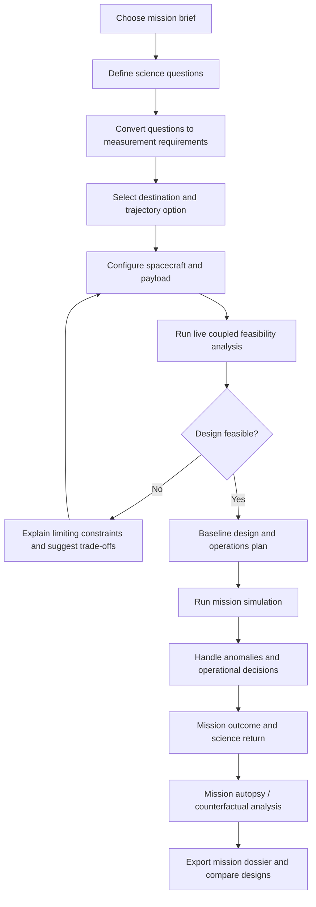
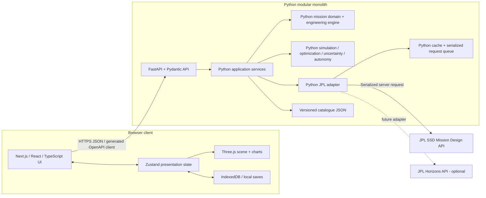
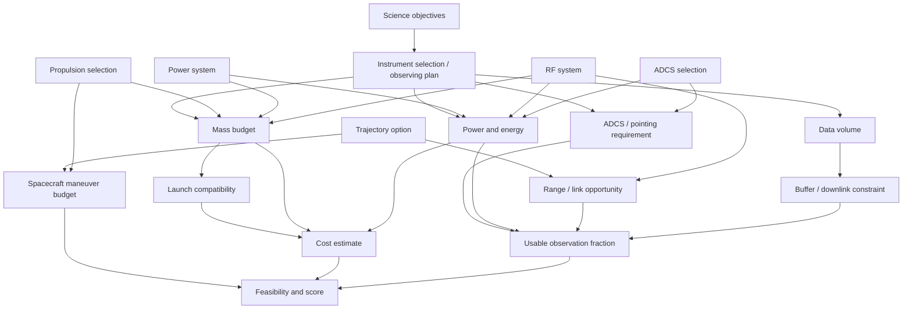

# MISSIONFORGE — Software Architecture

**Document type:** Technical architecture and implementation specification  
**Status:** Build-ready baseline for a hackathon MVP  
**Version:** 1.1  
**Date:** 2026-10-31  
**Product:** MISSIONFORGE — an evidence-aware, interactive space-mission design and operations simulator

> **Positioning and accuracy statement**  
> MISSIONFORGE is an independent educational prototype. It is not a NASA product, does not represent NASA, and is not flight-design or mission-certification software. Every engineering result must be labeled as source-backed, derived from a stated model, or an illustrative gameplay estimate. Do not imply that conceptual calculations are suitable for flight decisions.

---

## 1. Architecture decisions at a glance

| Decision | Baseline | Why |
|---|---|---|
| Product shape | Single-player, browser-based mission engineering game with optional team mode deferred | Immediate demo value; no account system required |
| Primary differentiator | Science-to-system traceability + live coupled trade studies + deterministic mission simulation + explainable mission autopsy | Shows real systems thinking rather than a component-shopping game |
| Flagship scenario | Near-Earth asteroid reconnaissance / rendezvous, using JPL small-body mission-design data when available | Authentic live data, distinctive story, and clear trajectory trade-offs |
| Other launchable scenarios | Earth-observation LEO and lunar polar scout presets | Demonstrates extensibility without pretending every destination has equal trajectory fidelity |
| Frontend | Next.js App Router, React, TypeScript, Tailwind CSS, shadcn/ui | Presentation, interaction, browser state and visualization only; no authoritative engineering calculations |
| Backend / main architecture | Python 3.12+, FastAPI, Pydantic v2 | The canonical mission model, engineering analysis, simulation, optimization, uncertainty, science autonomy, scheduling and JPL integration are implemented in Python |
| Visualization | Three.js / React Three Fiber for a stylized solar-system scene; Recharts for engineering plots | Strong visual impact with familiar libraries |
| Client state | Zustand + URL-addressable mission IDs; IndexedDB/localStorage persistence | Predictable state and save/restore without requiring a database |
| Validation | Pydantic v2 models at Python API/domain boundaries; generated TypeScript API types from FastAPI OpenAPI | One canonical validation/schema source; avoid duplicated frontend/backend contracts |
| Domain and simulation | Pure Python packages under `backend/app/domain`; deterministic seeded event simulation | Testable with pytest, reusable by FastAPI services, and independent of UI/network I/O |
| External data | Server-side JPL SSD Small-Body Mission Design API adapter; optional Horizons adapter later | JPL terms prohibit embedding the API in a website and require fair-use controls |
| Persistence | Local-first for hackathon; optional Supabase/Postgres after MVP | Avoid authentication and database work becoming critical-path blockers |
| Tests | pytest for Python domain/API, Playwright for browser journey, OpenAPI contract tests | Protect the science and systems calculations first |
| Deployment | Next.js frontend plus one Python/FastAPI backend deployment; static fallback data bundled with app | Keep the engineering platform as one modular Python backend; do not split it into microservices |

### Non-negotiable architecture rules

1. **Python is the mandatory implementation language for the main architecture.** The canonical mission model and all authoritative engineering/domain systems live in `backend/app/` as Python modules. The simulation engine is pure Python and must not import React, Next.js, browser APIs, a database client, FastAPI request objects, or network clients.
2. The TypeScript frontend is a client of the Python API, not a second engineering engine. It must not reimplement or independently calculate authoritative physics, scoring, optimization, simulation, uncertainty, autonomy or scheduling. The browser never calls the JPL SSD API directly; all external requests go through Python server-side adapters.
3. SI units are the canonical internal representation: kg, m, s, W, J, bit/s, Hz, K, Pa, and rad. Display units are converted at the UI boundary.
4. Every numeric result carries `value`, `unit`, `modelId`, `provenance`, `uncertainty`, and a human-readable explanation where applicable.
5. Hard feasibility constraints are separate from the weighted game score. A high score must never conceal an impossible design.
6. A run is reproducible from `missionState`, `engineVersion`, `catalogVersion`, and `randomSeed`.
7. Use a deterministic, seeded Python pseudo-random generator (for example, an explicitly passed `random.Random` instance). Never use unseeded randomness in scoring, optimization, robustness or simulation code.
8. No invented NASA endorsement, NASA seals, NASA logos, or wording that suggests official NASA affiliation.

---

## 2. Product thesis and research basis

### 2.1 The problem to solve

The challenge asks for an interactive game in which participants design, manage, and simulate an end-to-end space mission while making trade-offs across mission objectives, spacecraft design, instruments, launch vehicles, budgets, power, mass, communications, and orbital constraints. The experience should make coupled systems decisions tangible rather than treating each subsystem as an isolated quiz.

MISSIONFORGE's central thesis:

> A player should be able to trace every important engineering decision forward to a mission consequence and backward to the scientific objective it supports.

### 2.2 Research translated into product architecture

| Research / authoritative source | Relevant finding or method | Direct design consequence |
|---|---|---|
| Marcus, Legesse & Richardson, *A Model-Based Framework for NASA Science Mission Formulation* (2023 SciTech manuscript) | A system architecture model can link mission requirements, structure, Master Equipment List (MEL), Science Traceability Matrix (STM), Mission Traceability Matrix (MTM), key performance parameters, and simulations. | One canonical `MissionState` is the digital mission model. Generate STM/MTM views and equipment/budget summaries from it; do not maintain separate inconsistent forms. |
| Zadeh & Shirazi, *Multidisciplinary design optimization architecture to concurrent design of satellite systems*, DOI: 10.1177/0954410016665412 | Satellite design couples mission analysis, payload, structures, ADCS, communications, C&DH, power, and thermal disciplines under conflicting objectives. | Recompute coupled constraints whenever a component changes. Show cross-subsystem impacts, not only per-card stats. |
| *Large-Scale Multidisciplinary Optimization of a Small Satellite’s Design and Operation*, DOI: 10.2514/1.A32751 | Orbit, attitude, illumination, temperature, power storage, and communications interact; design and operational decisions can both materially influence delivered data. | Model the design and the operational plan together. A good payload is useless if pointing, power, or downlink cannot support it. |
| *Preliminary space mission design under uncertainty*, Acta Astronautica (2009), DOI: 10.1016/j.actaastro.2009.09.005 | Early mission design has epistemic and aleatory uncertainty; robust design considers how uncertainty changes feasibility and performance. | Display margin and uncertainty bands. Include a repeatable Monte Carlo “robustness” estimate in the mission review. Label distributions as educational approximations. |
| NASA Systems Engineering Handbook, NASA/SP-2016-6105 Rev. 2 | Mission/project lifecycle, requirements, design, product realization, technical management, verification and validation. | Build requirements, verification checks, risk, and review gates into the mission journey—not only as a score at the end. |
| NASA State-of-the-Art of Small Spacecraft Technology, 2026 online edition (published May 2026; public technology information through April 1, 2026) | Current public survey spanning platforms, power, propulsion, GNC, structures, thermal, avionics, communications, integration/launch, and mission operations. | Source subsystem catalogue facts from the relevant chapter and store citation, edition, retrieval date, applicability, and TRL context with each record. Do not confuse this with the older 2025 NTRS report, whose evidence cutoff was September 30, 2024. |
| JPL Small-Body Mission Design API v1.2 (July 2025) | Mode A returns accessible small bodies; Q returns stored mission options; M computes mission options suitable for launch-time/time-of-flight maps; T screens small bodies near a specified heliocentric orbit. | Use server-side JPL data for asteroid candidate discovery and launch-window exploration. Use an adapter so the rest of the game is independent of JPL response formats. |
| NASA VISITOR software description, LAR-18538-1 | A modular patched-conic MGA-1DSM model combines trajectory, mass, launch-window, and arrival/departure operations; validation against seven flown missions reported average total mission delta-V offset of 9.1%, reduced to 7.3% with a genetic algorithm at higher compute cost. | Do not attempt to recreate a high-fidelity interplanetary optimiser in a weekend. Use JPL's computed options for the flagship asteroid scenario; make any in-house trajectory model explicitly low-fidelity. |
| JPL Deep Space Network Telecommunications Link Design Handbook 810-005 | Defines technical performance and interface information for forward and return links between spacecraft and DSN. | The communications panel exposes a transparent link-budget model and its assumptions; do not reduce communications to an arbitrary “signal” stat. |
| Serious-games research: *Games for teaching and training decision-making in engineering: a systematic literature review* (2026), DOI: 10.1080/03043797.2026.2672137 | Review of 33 studies finds potential for motivation, safe experimentation, and socio-technical decision simulation, while noting methodological limitations in outcome evaluation. | Pair game engagement with measurable learning outcomes: pre/post concept checks, decision explanations, and an evidence-based debrief. |
| *Gamification in engineering education – An empirical assessment on learning and game performance*, Heliyon (2020), DOI: 10.1016/j.heliyon.2020.e04972 | Reports positive effects in an engineering-course gamification intervention across academic and social outcomes. | Use optional challenges, mastery badges, and cooperative role prompts only when they reinforce engineering behaviour. Avoid points for merely spending more. |

**Research implementation rule:** The papers guide system decomposition, coupling, uncertainty, traceability, and learning design. They do not supply a ready-made universal spacecraft model. Any numerical coefficient not directly obtained from an authoritative source must be marked as an explicit model assumption or gameplay estimate.

---

## 3. System context and user journey

### 3.1 Main loop



### 3.2 Player roles

MVP is single-player with “discipline lenses” that can be switched in the UI. Future team mode can assign roles:

- Mission Director: goals, budget, priorities, go/no-go decisions.
- Science Lead: objectives, observation requirements, payload selection, science yield.
- Spacecraft Engineer: bus, structures, power, propulsion, ADCS, thermal.
- Flight Dynamics Lead: orbit, launch window, trajectory, navigation margin.
- Flight Operations Lead: timeline, downlink, anomaly response, safe mode.

The role model is a UX framing mechanism, not a separate permission system in the MVP.

### 3.3 Core user-facing pages

1. **Landing / mission briefing** — product promise, three scenario cards, quick “start a guided mission” CTA.
2. **Mission brief** — objective, target, timeframe, budget, required science outcomes, difficulty.
3. **Science lab** — objective-to-measurement-to-instrument traceability graph.
4. **Mission architect** — spacecraft visual, subsystem catalogue, live budgets, hard-constraint alerts.
5. **Trade-study bay** — compare up to three saved architectures; Pareto plot and delta explanations.
6. **Mission control** — phase timeline, orbital scene, telemetry, event queue, decision cards.
7. **Mission review** — science returned, mission outcome, cost/resources, risks realized, confidence bands, counterfactuals, export.

---

## 4. Scope, fidelity, and anti-scope

### 4.1 Hackathon MVP scope

| Feature | MVP commitment | Fidelity |
|---|---|---|
| Three mission scenarios | Earth observation LEO, lunar polar scout, asteroid reconnaissance/rendezvous | Curated scenario definitions; target/trajectory detail depends on data provider |
| Science traceability | Science objective → measurement requirement → payload capability | Deterministic educational proxy with explanations |
| Component catalogue | Launch option, spacecraft bus, power, propulsion, ADCS, comms, C&DH, thermal, instruments | Curated records with provenance and simplified performance attributes |
| Live budgets | Mass, power/energy, delta-v/propellant, communications/data volume, cost proxy, risk | Transparent analytical models and hard checks |
| External mission data | JPL Small-Body Mission Design API Modes A/Q; M optional if time allows | Source-backed API results, cached and version-checked |
| Mission simulation | Discrete phases, telemetry, scripted anomalies, player decisions | Deterministic hybrid event simulation; not high-fidelity orbital propagation |
| Robustness estimate | Seeded Monte Carlo samples | Preliminary educational uncertainty model |
| Debrief | Explain mission outcome, top constraints, what-if redesign | Rule-based, deterministic explanation system |
| Dossier export | JSON plus printable HTML/PDF optional | Required: JSON and print stylesheet; PDF optional |

### 4.2 Explicitly out of scope for hackathon

- Flight-qualified trajectory design, navigation, attitude dynamics, thermal finite-element analysis, structural analysis, or radiation transport.
- A general-purpose replacement for GMAT, STK, MONTE, Copernicus, or NASA/JPL flight design tools.
- Real-time ephemeris propagation at high precision.
- Authentication, social feeds, marketplace, chat, payment, or public leaderboard backend.
- Unrestricted AI-generated engineering numbers or a generative model in the simulation critical path.
- Official NASA branding or any claim of NASA affiliation.

### 4.3 Fidelity tiers

All calculations and displayed outputs must carry one of these fidelity badges:

- **Tier 0 — Source-backed:** value returned from a documented API or published source. Must include source, version/date, units, and retrieval time.
- **Tier 1 — Derived:** value computed from a documented equation using Tier 0 values or user-entered assumptions. Show equation and input references.
- **Tier 2 — Gameplay estimate:** simplified scenario or game-balancing value. Visibly label as illustrative; include model assumptions.
- **Tier 3 — Not modelled:** the UI must not imply a numeric prediction. Use a qualitative warning or omit the metric.

Do not blend tiers without labeling each contributor. An API-sourced asteroid trajectory does not make a guessed spacecraft budget source-backed.

---

## 5. High-level technical architecture

**Language boundary (mandatory):** the main MISSIONFORGE architecture is Python. Python owns the canonical domain model and every authoritative engineering or mission-system algorithm. TypeScript is reserved for the browser UI, visualizations, local interaction state and the generated API client. This is a deliberate separation of responsibilities, not a dual-language implementation of the same logic.



### 5.1 Modular monolith, not microservices

Use one Next.js frontend and **one Python/FastAPI backend modular monolith**. They may run as two processes or deployable units because they use different runtimes, but the Python backend must remain a single cohesive application with internal package boundaries. Do not create separate Python microservices for analysis, simulation, optimization, JPL access or scheduling. FastAPI routes call Python application services; those services call pure Python domain modules. Heavy analysis must not be moved into React or duplicated in TypeScript.

### 5.2 Suggested repository layout

```text
missionforge/
├── README.md
├── architecture.md
├── module_breakdown.md
├── prod.md
├── research_basis.md
├── .env.example
├── data/
│   ├── catalog/
│   └── missions/
├── backend/
│   ├── pyproject.toml
│   ├── uv.lock
│   ├── app/
│   │   ├── main.py
│   │   ├── api/
│   │   │   ├── deps.py
│   │   │   └── routes/
│   │   │       ├── catalog.py
│   │   │       ├── templates.py
│   │   │       ├── missions.py
│   │   │       ├── space_data.py
│   │   │       └── health.py
│   │   ├── schemas/          # Pydantic request/response contracts
│   │   ├── services/         # application orchestration
│   │   ├── domain/           # authoritative, pure Python mission logic
│   │   │   ├── units/
│   │   │   ├── mission/
│   │   │   ├── catalog/
│   │   │   ├── analysis/
│   │   │   ├── traceability/
│   │   │   ├── optimization/
│   │   │   ├── uncertainty/
│   │   │   ├── science_belief/
│   │   │   ├── operations/
│   │   │   ├── simulation/
│   │   │   ├── health_monitor/
│   │   │   └── dossier/
│   │   ├── integrations/
│   │   │   └── jpl/
│   │   └── infrastructure/
│   │       ├── cache/
│   │       └── queue/
│   ├── tests/
│   │   ├── unit/
│   │   ├── contract/
│   │   └── integration/
│   └── scripts/
│       ├── validate_catalog.py
│       └── capture_demo_data.py
├── frontend/
│   ├── package.json
│   ├── pnpm-lock.yaml
│   ├── next.config.ts
│   ├── tsconfig.json
│   ├── src/
│   │   ├── app/
│   │   ├── components/
│   │   ├── state/            # Zustand presentation state only
│   │   ├── hooks/
│   │   └── lib/              # generated API types/client, formatting
│   └── tests/e2e/
└── public/
    └── data/demo-jpl-snapshot.json
```

The `backend/app/domain` package is the only source of truth for mission calculations and domain behaviour. Pydantic models in `backend/app/schemas` define validated API boundaries and are reused by backend services. FastAPI publishes the OpenAPI schema; generate or derive the frontend TypeScript API types/client from that schema rather than hand-maintaining a second set of domain contracts. The frontend may cache and display server results, but it must not produce competing engineering results.

Do not create files for every future subsystem before the vertical slice works. The tree is the target organization; implement only what the first end-to-end flow requires.

## 6. Canonical domain model

### 6.1 Core principle: one source of truth

The `MissionState` is the only editable mission design model. The UI may hold transient form state, but saved design decisions must map into this object. All budgets, traceability views, validation, scoring, and simulation inputs are derived from it.

### 6.2 Python / Pydantic contract (canonical implementation)

The following is the authoritative implementation direction. Use Python 3.12+ and Pydantic v2. Python field names use `snake_case`; Pydantic's alias generator may expose the established `camelCase` JSON shape to the frontend. Do not create an independently maintained TypeScript definition of `MissionState` or engineering outputs. Generate browser API types from FastAPI's OpenAPI document.

```python
from datetime import date, datetime
from typing import Any, Literal
from pydantic import BaseModel, ConfigDict, Field


def to_camel(value: str) -> str:
    head, *tail = value.split("_")
    return head + "".join(part.capitalize() for part in tail)


class ContractModel(BaseModel):
    model_config = ConfigDict(
        alias_generator=to_camel,
        populate_by_name=True,
        extra="forbid",
    )


Fidelity = Literal["source-backed", "derived", "gameplay-estimate", "not-modelled"]
Unit = Literal[
    "kg", "m", "s", "day", "km", "km/s", "m/s", "W", "Wh", "J",
    "bit/s", "bit", "Hz", "dB", "dBW", "K", "USD", "USD_2026", "%", "rad", "deg",
]


class Provenance(ContractModel):
    fidelity: Fidelity
    source_name: str
    source_url: str | None = None
    source_version: str | None = None
    retrieved_at: datetime | None = None
    published_at: date | None = None
    assumptions: list[str] = Field(default_factory=list)
    notes: str | None = None


class Uncertainty(ContractModel):
    distribution: Literal["normal", "uniform", "triangular", "interval"]
    min: float | None = None
    mode: float | None = None
    max: float | None = None
    sigma: float | None = None


class Quantity(ContractModel):
    value: float
    unit: Unit
    provenance: Provenance
    uncertainty: Uncertainty | None = None


class MeasurementRequirement(ContractModel):
    id: str
    description: str
    instrument_capability: str
    target_threshold: Quantity | None = None
    coverage_weight: float = Field(ge=0)
    required: bool = True


class ScienceObjective(ContractModel):
    id: str
    title: str
    question: str
    priority: float = Field(gt=0)
    required_measurements: list[MeasurementRequirement]


class ComponentSelection(ContractModel):
    component_id: str
    quantity: int = Field(gt=0)
    enabled: bool = True
    overrides: dict[str, float | str | bool] = Field(default_factory=dict)


class Destination(ContractModel):
    body_id: str
    name: str
    body_type: str
    source: Provenance | None = None


class TrajectorySelection(ContractModel):
    provider: Literal["jpl-mdesign", "scenario-preset", "manual-estimate"]
    option_id: str
    departure_date: date
    arrival_date: date | None = None
    time_of_flight_days: float | None = None
    c3_km2_per_s2: float | None = None
    departure_v_infinity_km_per_s: float | None = None
    arrival_v_infinity_km_per_s: float | None = None
    mission_delta_v_km_per_s: float | None = None
    raw_source_ref: str | None = None


class SpacecraftArchitecture(ContractModel):
    launch_vehicle_id: str
    bus_id: str
    propulsion_id: str
    power_id: str
    adcs_id: str
    communications_id: str
    thermal_id: str
    cdh_id: str
    instrument_ids: list[str]
    ground_segment_id: str


class ObservationPlanItem(ContractModel):
    measurement_id: str
    start_day: float = Field(ge=0)
    duration_hours: float = Field(gt=0)
    duty_cycle: float = Field(ge=0, le=1)


class DownlinkPlanItem(ContractModel):
    start_day: float = Field(ge=0)
    duration_minutes: float = Field(gt=0)
    data_rate_bits_per_second: float = Field(gt=0)


class OperationsPlan(ContractModel):
    mission_duration_days: float = Field(gt=0)
    observation_plan: list[ObservationPlanItem]
    downlink_plan: list[DownlinkPlanItem]
    safe_mode_policy: Literal["conservative", "balanced", "aggressive"]
    autonomy_level: Literal["ground-led", "supervised", "autonomous"]


class MissionConstraints(ContractModel):
    maximum_budget_usd: float = Field(gt=0)
    launch_mass_limit_kg: float | None = Field(default=None, gt=0)
    minimum_science_score: float | None = None
    minimum_success_probability: float | None = Field(default=None, ge=0, le=1)
    mass_margin_fraction: float = Field(ge=0)
    power_margin_fraction: float = Field(ge=0)
    data_margin_fraction: float = Field(ge=0)
    delta_v_margin_km_per_s: float = Field(ge=0)


class MissionState(ContractModel):
    schema_version: Literal["1.0"] = "1.0"
    mission_id: str
    title: str
    scenario_id: Literal["neo-rendezvous", "lunar-polar-scout", "earth-observation"]
    created_at: datetime
    updated_at: datetime
    design_revision: int = Field(ge=0)
    science_objectives: list[ScienceObjective]
    destination: Destination
    trajectory: TrajectorySelection
    architecture: SpacecraftArchitecture
    operations: OperationsPlan
    constraints: MissionConstraints
    random_seed: int
```

The actual implementation may split these models into smaller Python modules, but it must preserve the concepts and avoid duplicating computed values in editable state. Pydantic validation is authoritative at API/import boundaries. Domain functions should accept validated Python models or explicit immutable domain values and return typed Python outputs.

### 6.3 Catalogue record schema

Each component catalogue record must include:

```python
from typing import Literal
from pydantic import Field


class FailureMode(ContractModel):
    id: str
    description: str
    base_probability: float = Field(ge=0, le=1)
    affected_metric: str
    severity: int = Field(ge=1, le=5)
    mitigation_ids: list[str] = Field(default_factory=list)


class CompatibilityRule(ContractModel):
    category: str
    ids: list[str] | None = None
    tags: list[str] | None = None


class CatalogComponent(ContractModel):
    id: str
    name: str
    category: Literal[
        "launch", "bus", "propulsion", "power", "adcs", "communications",
        "thermal", "cdh", "instrument", "ground",
    ]
    description: str
    tags: list[str] = Field(default_factory=list)
    parameters: dict[str, Quantity]
    capabilities: list[str] = Field(default_factory=list)
    compatible_with: list[CompatibilityRule] = Field(default_factory=list)
    failure_modes: list[FailureMode] = Field(default_factory=list)
    source_record_id: str
    provenance: Provenance
    is_illustrative: bool = False
```

Do not use vendor/product marketing figures without a traceable public source. If a component has no credible public data, populate it as an explicitly illustrative archetype rather than a supposedly real product.

### 6.4 Analysis output schema

```python
class SuggestedAction(ContractModel):
    action_id: str
    label: str
    expected_effect: str


class ConstraintResult(ContractModel):
    id: str
    label: str
    status: Literal["pass", "warning", "fail", "not-modelled"]
    actual: Quantity | None = None
    limit: Quantity | None = None
    margin_fraction: float | None = None
    severity: int = Field(ge=0, le=3)
    explanation: str
    impacted_subsystems: list[str] = Field(default_factory=list)
    suggested_actions: list[SuggestedAction] = Field(default_factory=list)


class BudgetAnalysis(ContractModel):
    dry_mass_kg: Quantity
    propellant_mass_kg: Quantity
    wet_mass_kg: Quantity
    mass_margin_fraction: float
    average_power_w: Quantity
    peak_power_w: Quantity
    energy_margin_fraction: float
    data_generated_bits: Quantity
    data_downlinked_bits: Quantity
    data_margin_fraction: float
    required_delta_v_km_per_s: Quantity
    available_delta_v_km_per_s: Quantity
    delta_v_margin_km_per_s: float
    estimated_cost_usd: Quantity


class ScienceAnalysis(ContractModel):
    coverage_score: float
    weighted_objective_coverage: dict[str, float]
    missing_requirements: list[str]


class ReliabilityAnalysis(ContractModel):
    nominal_reliability: float
    risk_index: float
    single_point_failures: list[str]


class MissionAnalysis(ContractModel):
    mission_id: str
    design_revision: int
    engine_version: str
    catalog_version: str
    calculated_at: datetime
    budgets: BudgetAnalysis
    science: ScienceAnalysis
    reliability: ReliabilityAnalysis
    constraints: list[ConstraintResult]
```

All engineering results are produced by Python domain functions. The frontend may render these models, but it must not recalculate them.

## 7. Engineering analysis models

### 7.1 General calculation contract

Every discipline model is a pure function:

```python
def analyze_subsystem(input_model, catalog, scenario) -> SubsystemAnalysis:
    ...
```

Rules:

- Validate input ranges before calculating.
- Return structured errors rather than `NaN`, `Infinity`, or silent defaults.
- Keep unit conversions in `domain/units` only.
- Return the model name/version and provenance for every output.
- Keep `assumptions[]` adjacent to model output and surface them in the UI.
- Use decimal precision internally; round only for display.
- Include test vectors from hand calculations for core equations.

### 7.2 Mass budget

**Inputs:** bus dry mass, selected subsystem masses, instrument masses, harness/adapter estimates, propellant, margin policy, launch limit.

**Model:**

```text
payloadMass       = sum(instrument.mass * quantity)
subsystemDryMass  = sum(bus + propulsion hardware + EPS + ADCS + comms + C&DH + thermal + structure + ground interface)
dryMass           = payloadMass + subsystemDryMass
wetMass           = dryMass + propellantMass
allocatedMass     = wetMass * (1 + massMarginFraction)
marginToLimit     = (launchMassLimit - allocatedMass) / launchMassLimit
```

Important: do not add a generic structural percentage if the bus record already contains primary structure mass. Include only explicit “unallocated growth mass” as a margin line. Display a mass breakdown and identify the components causing the top 80% of mass.

**Hard constraints:** launch mass limit; mass margin threshold; bus/payload compatibility. A mass limit is not the same thing as C3 capability.

### 7.3 Propulsion and delta-v

Use the ideal rocket equation for a transparent first-order sizing model:

```text
DeltaV = Isp * g0 * ln(m0 / mf)
m0 = mf * exp(DeltaV / (Isp * g0))
propellantMass = m0 - mf
```

where `g0 = 9.80665 m/s^2`; `Isp` is seconds; mass is kg; delta-v is m/s. Implement checks for positive `Isp`, `m0 > mf`, and positive mass.

- Treat JPL `c3_dep` (km²/s²), departure `vinf`, arrival `vinf`, and `dv_tot` as distinct parameters. Never add C3 directly to delta-v.
- Convert JPL km/s to m/s at the adapter/domain boundary.
- In the MVP, the trajectory provider supplies the heliocentric transfer opportunity; the spacecraft propulsion model sizes only the maneuver budget explicitly assigned to the spacecraft (e.g. capture, rendezvous, correction, station-keeping). State clearly whether a trajectory field is launch energy or onboard delta-v.
- If the scenario uses a precomputed trajectory with a `dv_tot` value, display it as a mission-level trajectory metric. Do not treat it as spacecraft-only maneuver delta-v unless the API definition/mission model justifies that interpretation.
- Add propulsion technology trade-offs: chemical (high thrust, lower Isp), electric (high Isp, low thrust, long burn), and cold gas (simple/low thrust, limited total impulse). Values must come from catalogued, sourced or explicitly illustrative records.

**Constraint:** available spacecraft maneuver delta-v must exceed required maneuver delta-v plus configured margin. Report which maneuver consumes the reserve.

### 7.4 Power and energy budget

The power analysis must distinguish instantaneous power (W) from energy (Wh or J).

```text
Pavg = sum(Pi * dutyCycle_i)
E_load = sum(Pi * activeSeconds_i) / 3600         // Wh
P_solar = solarFluxAtDistance * panelArea * cellEfficiency * EPS_efficiency * cos(incidenceAngle)
solarFluxAtDistance = solarConstant / distanceAU^2
E_battery_required = E_eclipse / (usableDepthOfDischarge * dischargeEfficiency)
```

For the MVP, use a per-phase or per-orbit energy ledger instead of pretending to simulate every cell and thermal effect. The energy state at each step is:

```text
batteryNextWh = clamp(batteryWh + generatedWh - consumedWh, 0, batteryCapacityWh)
```

- Enforce an explicit usable depth-of-discharge limit.
- Account for degradation/temperature only if the catalogue contains the parameter; otherwise make it a documented gameplay assumption.
- Include payload, avionics, ADCS, transmitter, heater, and propulsion loads when enabled.
- Check both peak power and energy closure. A system can pass average power and still fail a peak load.

**Constraints:** peak load <= regulated peak supply; energy reserve stays above minimum SOC; solar energy over the period replenishes the consumed energy within configured margin.

### 7.5 Communications and data budget

Use a transparent simplified RF link budget. Do not present the result as a DSN-compatible design certification.

```text
lambda = c / carrierFrequencyHz
FSPL_dB = 20 * log10(4 * pi * rangeMeters / lambda)
Pr_dBW = Pt_dBW + Gt_dBi + Gr_dBi - FSPL_dB - otherLosses_dB
N0_dBW_per_Hz = 10 * log10(kB * systemNoiseTemperatureK)
C_N0_dBHz = Pr_dBW - N0_dBW_per_Hz
Eb_N0_dB = C_N0_dBHz - 10 * log10(bitRateBitsPerSecond)
linkMargin_dB = Eb_N0_dB - requiredEbN0_dB
```

`kB = 1.380649e-23 J/K`; `c = 299792458 m/s`. Validate units and keep antenna gain, cable/polarization/implementation losses, coding threshold, and pointing loss explicit.

Data model:

```text
generatedBits = sum(instrumentDataRate * observingSeconds * compressionFactor)
downlinkedBits = sum(contactBitRate * contactSeconds * protocolEfficiency * availabilityFraction)
bufferEnd = max(0, bufferStart + generatedBits - downlinkedBits)
```

Hard constraints: buffer capacity; non-negative link margin for a “green” contact; data backlog does not exceed storage before the next viable contact. A warning is acceptable when the design can safely store data and downlink later.

The Deep Space Network 810-005 handbook is the reference for the link-design framing and parameter categories; detailed operational performance remains out of scope.

### 7.6 Thermal approximation

Thermal is a **qualitative / Tier 2** constraint unless validated material, optical, environment, and geometry inputs are supplied. Do not claim to solve thermal balance fully.

MVP approach:

- Each component defines an allowed operating temperature band and a mission-environment exposure class.
- Estimate a risk flag using scenario conditions, duty cycle, and thermal-control selection.
- Report a thermal constraint as `warning` or `not-modelled` unless the simplified model has enough parameters.
- Do not generate precise temperatures from arbitrary multipliers.

Optional educational model for later: lumped-node radiative balance `Q = epsilon * sigma * A * (T^4 - T_space^4)` plus absorbed solar/albedo/planet IR, but this is not a substitute for thermal engineering analysis.

### 7.7 Orbit and trajectory

Use a tiered approach:

- **Asteroid flagship:** obtain target/mission opportunity values from JPL Small-Body Mission Design API. Mode A screens accessible objects; Q retrieves stored mission options; M produces launch-date/time-of-flight sweep data for porkchop-style visualization. Respect the API's launch-year, target, step, span and time-of-flight limits.
- **Earth orbit:** use a scenario preset for reference orbit altitude, inclination, and mission duration; show a simple two-body circular-orbit visualization. If using `T = 2*pi*sqrt(a^3/mu)` or `v = sqrt(mu/a)`, label assumptions (two-body, circular, point-mass central body).
- **Lunar scout:** use a curated transfer scenario with explicit fixed inputs. Do not imply the simple orbit graphic is a high-fidelity lunar trajectory.
- **Visualization:** draw stylized orbit paths and bodies. If no verified ephemeris is available, the visual is schematic and must be labeled “illustrative geometry.”

The NASA VISITOR description is the model-fidelity caution: validated interplanetary models are modular and account for multiple-gravity-assist, deep-space maneuvers, mass, launch windows and operations. MISSIONFORGE should consume validated precomputed options rather than claiming equivalent precision.

### 7.8 Cost estimate

Use a transparent **game cost index** in USD-equivalent, not an official NASA project cost estimate.

- Catalogue item cost estimates may be sourced public prices or explicit scenario estimates.
- Separate spacecraft hardware, launch/service, operations, ground segment, reserves, and development overhead.
- Use scenario-configured fixed costs and parametric multipliers for the MVP; label every unsourced factor `gameplay-estimate`.
- Show range (low / nominal / high) when source data supports it; otherwise show nominal estimate plus uncertainty label.
- Do not claim a parametric model is NASA's cost model (e.g. PRICE-H or NAFCOM).

### 7.9 Reliability, risk and FMEA

Model failure modes explicitly:

- Probability / occurrence estimate.
- Severity 1–5.
- Detectability 1–5 (higher means harder to detect).
- Affected mission function and phase.
- Mitigation / redundancy / operational response.

An educational risk priority number may be `RPN = occurrence * severity * detectability`; label it as a prioritization heuristic, not a probability. Nominal component reliability can be combined as `R_system = product(R_i)` only where the independence assumption is stated. Do not imply independence where shared power, thermal, software, or communications creates common-cause failures.

For Monte Carlo runs, sample explicit failure modes and margin uncertainty with a seeded RNG. Report sample count and confidence caveats. Use minimum 100 samples for MVP if latency allows; use 50 for live preview and 500–1000 for final result if performance allows.

### 7.10 Science return and instrument coverage

Use requirement coverage, not “more instruments = more science.”

```text
objectiveCoverage = sum(requirementWeight * achievedFraction) / sum(requirementWeight)
scienceScore = 100 * sum(objectivePriority * objectiveCoverage) / sum(objectivePriority)
```

- Each instrument declares the measurement capabilities it supports.
- Each requirement has a minimum threshold or categorical capability.
- Compute `achievedFraction` from supported capability, scheduled observation time, pointing/lighting availability proxy, and data successfully downlinked.
- Missing mandatory requirements are visible even if the total science score is high.
- Science that was collected but never returned is reported separately from science successfully downlinked.

All science scoring coefficients are educational proxies and must be labeled as such.

### 7.11 Overall scoring

**Hard feasibility gates first:** impossible mass, no valid trajectory option, unpowered spacecraft, impossible maneuver budget, or unrecoverable data-storage overflow produce an infeasible status. A score is still shown for learning, but the mission cannot receive the “mission-ready” badge.

Suggested game score (weights may be tuned, but must be displayed):

| Dimension | Weight | What it rewards |
|---|---:|---|
| Scientific return | 30 | Achieved objective coverage and delivered usable data |
| Mission execution | 25 | Critical phase completion, target acquisition, and end state |
| Engineering robustness | 20 | Positive margins, resilience, risk mitigation, and fault recovery |
| Resource stewardship | 15 | Budget and resource planning without destroying science return |
| Operations quality | 10 | Contact scheduling, duty-cycle planning, safe-mode choices, and anomaly decisions |

Do not reward component price or mass reduction in isolation. Normalize the score within a scenario and expose the formula in the review page.

---

## 8. Coupled trade-study engine

### 8.1 Why this is the core differentiator

Changing one subsystem must update all dependent constraints. Examples:

- A larger instrument improves measurement coverage but increases mass, peak/average power, data generation, cost, and potentially spacecraft pointing demand.
- A higher-gain antenna can improve downlink capability but may add mass, require better pointing, and compete for power.
- Electric propulsion can reduce propellant mass but may require more electrical power and longer thrust time.
- A larger battery improves eclipse survival but adds mass and budget.
- A larger launch vehicle may solve mass and launch-energy constraints but increase cost.

### 8.2 Dependency graph



### 8.3 Recalculation strategy

MVP does not need a full numerical optimizer. It needs reliable, fast, explainable recalculation.

1. `MissionState` changes and increments `designRevision`.
2. Build an immutable `AnalysisContext` with resolved catalogue records and source data.
3. Execute disciplines in topological order (or all pure functions in a single analysis coordinator).
4. Run cross-subsystem constraint checks.
5. Compute feasibility and score.
6. Derive `topDrivers` from failed/warning constraints and sensitivity deltas.
7. Return a complete `MissionAnalysis` tagged with `designRevision`.
8. UI ignores a stale response whose revision is older than the current design.

Target budget: local analysis under 100 ms for a single architecture on a normal laptop. Monte Carlo analysis runs as a bounded Python backend task; the browser displays progress/result state.

### 8.4 Trade-study methods

- **MVP:** compare 2–3 manually selected designs and show metric deltas.
- **Stretch:** generate a small set of catalogue swaps and keep non-dominated designs on a Pareto frontier (science, cost, mass, robustness).
- **Do not:** run a large genetic optimizer before the deterministic models and validation are tested.

Pareto dominance rule: design A dominates B if A is no worse on every objective and strictly better on at least one, after objective directions are normalized. Keep constraints visible; a dominated but feasible design may still be useful for a player objective.

---

## 9. Mission simulation architecture

### 9.1 Hybrid discrete-event model

The game is not a full N-body simulator. It is a deterministic event-driven operational simulation over mission phases, with simplified resource accounting at phase checkpoints.

Mission phases:

1. Pre-launch readiness review.
2. Launch and separation.
3. Commissioning.
4. Cruise / transfer.
5. Mid-course correction.
6. Target approach / insertion / rendezvous (scenario dependent).
7. Science operations.
8. Downlink and data return.
9. Extended mission or end-of-life.

Each phase has entry criteria, telemetry state, scheduled events, resource consumption, possible anomalies, and exit criteria.

### 9.2 Event model

```python
class MissionEvent(ContractModel):
    id: str
    mission_day: float
    phase: str
    type: Literal["milestone", "telemetry", "anomaly", "decision", "science", "downlink"]
    severity: Literal["info", "warning", "critical"]
    title: str
    description: str
    trigger: dict[str, Any]
    choices: list[dict[str, Any]] = Field(default_factory=list)
    resolved_by: str | None = None
```

### 9.3 Telemetry channels

MVP channels:

- Mission elapsed time / mission day.
- Phase and spacecraft mode.
- Remaining propellant fraction.
- Battery state of charge.
- Power generation, load, and margin.
- Data buffer usage and data delivered.
- Link margin / current downlink state.
- Attitude/pointing error proxy.
- Thermal status (qualitative unless model inputs justify numeric values).
- Health flags for primary power, communications, propulsion, ADCS, C&DH.

Every telemetry item includes unit, timestamp, and fidelity.

### 9.4 Anomaly design

Use deterministic rules driven by design choices and seeded uncertainty. Example events:

- Battery state approaches reserve during eclipse.
- Instrument data volume exceeds scheduled downlink capacity.
- Pointing accuracy degrades under an observation plan that exceeds ADCS capability.
- Propellant reserve is insufficient for an additional correction.
- A ground contact is missed and the buffer accumulates.
- A solar event prompts safe mode; player chooses science pause vs. risk exposure.

Do not randomly punish the player with unrelated failures. Every event must trace to a system weakness, an explicitly modeled uncertainty, or a scenario event. Provide “why this happened” in the event log.

### 9.5 Decision mechanics

Each decision must present:

- Situation and urgency.
- Current telemetry and the relevant threshold.
- Two or three feasible actions.
- Immediate trade-off (e.g. lower science time, lower power load, more risk, delayed downlink).
- Predicted effect and whether it is a deterministic rule or a scenario uncertainty.

At least one branch must preserve the ability to complete the learning journey even if the mission is lost (e.g. safe-mode recovery or diagnostic postmortem).

### 9.6 Reproducibility

The complete simulation input is:

```python
class SimulationInput(ContractModel):
    mission_state: MissionState
    analysis: MissionAnalysis
    engine_version: str
    catalog_version: str
    random_seed: int
    scenario_event_set_id: str
    monte_carlo_samples: int | None = None
```

Output includes immutable event log, telemetry checkpoints, outcomes, science return, realized risks, and final score. A given input plus engine/catalogue version must produce the same result.

---

## 10. External data: JPL adapter

### 10.1 API rules that affect the design

The JPL SSD API fair-use policy states:

- Requests must be reasonably necessary; cache/reuse unchanged or predictable data where practical.
- Automated clients should submit one request at a time, not concurrent bursts.
- Clients must handle errors, rate limits, and service unavailability with backoff.
- Automated clients must send a valid application-specific User-Agent containing product name, version, and contact information.
- The API may not be embedded in a website under the stated NASA CORS policy.
- Clients should check the output `signature.version` because payload formats can change.

Therefore: use a server-side adapter, serialize requests, set a transparent product User-Agent, cache the data, and fail gracefully to a clearly labeled local snapshot.

### 10.2 Adapter responsibilities

`JplMissionDesignClient`:

- Builds URLs from typed parameter objects; never concatenates untrusted raw query strings.
- Uses a backend-only async HTTP client (for example, `httpx.AsyncClient`) and an application-specific User-Agent.
- Has an overall request timeout (e.g. 10 seconds) and returns a typed result.
- Validates HTTP status and JSON schema.
- Validates `signature.version` against a supported version list.
- Preserves raw source payload (server side) for provenance/debugging, but only returns normalized fields to client.
- Implements a serial request queue with concurrency = 1.
- Uses capped exponential backoff for retryable errors (429, 5xx, network timeouts); do not retry non-retryable 4xx errors blindly.
- Does not retry faster than the source policy permits.
- Logs request ID, endpoint mode, status, duration, response version, cache hit/miss; never log private user data.

`JplMissionDesignRepository`:

- Cache key includes normalized mode and all query parameters.
- Suggested TTLs: mode A 12–24 h; mode Q 24 h; mode M 6–12 h. These are application cache choices, not JPL guarantees.
- Keep stale cache for a degraded-but-usable fallback; clearly show “cached data” and fetched-at date.
- Bundle one known-good demo snapshot for the finalist demo if external network is unavailable.

### 10.3 MVP endpoints

| Game endpoint | JPL mode | Input | Normalized output |
|---|---|---|---|
| `GET /api/space-data/neo-accessible?years=2027,2028&criterion=1&limit=50` | A | launch years, objective criterion, limit, optional filter | target list, departure/arrival dates, C3, V-infinity, delta-v, time of flight, object flags, orbit condition code |
| `GET /api/space-data/neo/[designation]` | Q | target designation/name | precomputed mission options for selected object |
| `GET /api/space-data/neo-map?...` | M (stretch) | target, MJD start, span, min/max TOF, step | launch/arrival grid for porkchop visualization |
| — | T (deferred) | heliocentric orbit elements and date range | target candidates near mission orbit |

Use the exact parameter names documented by JPL. The adapter maps the JPL column-array format (`fields` + `records`) into typed objects; never have UI components read raw array indices.

### 10.4 JPL response normalization

Expected `Mode A` response includes a `signature`, `fields`, `constraints`, and `records`. Convert each row by using the matching field name index, not by hardcoding `row[8]` in UI code.

```python
class JplMissionOption(ContractModel):
    designation: str
    name: str
    departure_date: date
    arrival_date: date
    c3_km2_per_s2: float
    departure_v_infinity_km_per_s: float
    arrival_v_infinity_km_per_s: float
    total_delta_v_km_per_s: float
    time_of_flight_days: float
    orbit_class: str
    absolute_magnitude: float | None = None
    orbit_condition_code: float | None = None
    is_near_earth_object: bool
    is_potentially_hazardous: bool
    is_binary: bool
    source: Provenance
```

Store both raw response version and normalized model version. If an unknown version arrives, return stale cache or demo data with a visible degraded status. Do not silently parse unknown schemas.

### 10.5 Data provenance UX

Every externally sourced value must open a small “Source & assumptions” popover with:

- Provider and dataset/API name.
- Source link.
- API version / catalogue edition.
- Retrieval date/time.
- Unit and conversion applied.
- Fidelity badge.
- Any known uncertainty notes.

---

## 11. API design (application layer)

All routes are JSON, implemented in FastAPI, and validate requests/responses with Pydantic v2 models. Return stable error envelopes and include schema versions in payloads. Do not expose raw JPL responses directly. FastAPI OpenAPI is the contract source used to generate frontend TypeScript types.

### 11.1 Common response envelope

```python
from typing import Generic, TypeVar

T = TypeVar("T")


class ApiMeta(ContractModel):
    request_id: str
    schema_version: Literal["1.0"] = "1.0"
    generated_at: datetime | None = None
    source_status: Literal["live", "cached", "demo"] | None = None


class ApiError(ContractModel):
    code: str
    message: str
    retryable: bool
    details: dict[str, Any] | None = None


class ApiResult(ContractModel, Generic[T]):
    ok: bool
    data: T | None = None
    error: ApiError | None = None
    meta: ApiMeta
```

### 11.2 Endpoints

#### `GET /api/catalog`
Returns catalogue groups, catalogue version, and source summaries. No user-specific data.

#### `GET /api/templates`
Returns scenario templates and their default mission states. Defaults must include all assumptions and fidelity flags.

#### `POST /api/mission/validate`
Request: `{ missionState }`  
Response: `{ analysis }`  
Side effects: none. Deterministic and idempotent.

#### `POST /api/mission/trade-study`
Request: `{ baseMissionState, alternatives: MissionState[] }` (max 3 for MVP).  
Response: analysis per design, deltas, feasibility, and optional Pareto classification.

#### `POST /api/mission/simulate`
Request: `{ missionState, randomSeed, scenarioEventSetId, monteCarloSamples? }`  
Response: `{ analysis, run, telemetry, events, finalReport }`.  
Set a strict max payload and time budget. Long Monte Carlo can be executed as a bounded Python background task later; the engine itself remains in the Python backend.

#### `GET /api/space-data/neo-accessible`
Query: `years`, `criterion`, `limit`.  
Response: normalized JPL targets and `sourceStatus`.

#### `GET /api/space-data/neo/[designation]`
Response: target metadata and stored mission options.

#### `GET /api/space-data/neo-map`
Stretch. Response: normalized grid plus launch/arrival axes.

#### `GET /api/health`
Returns app build, engine version, catalogue version, JPL adapter status (do not expose API secrets or environment values).

### 11.3 Error codes

- `VALIDATION_ERROR` — malformed input.
- `MISSION_INFEASIBLE` — valid input, but design violates hard constraints (not an API failure).
- `CATALOG_ITEM_NOT_FOUND` — stale/missing selected component.
- `JPL_UNAVAILABLE` — no fresh upstream response and no cached response.
- `JPL_RATE_LIMITED` — upstream has asked client to slow down.
- `JPL_SCHEMA_UNSUPPORTED` — response signature/version is not supported.
- `SIMULATION_LIMIT_EXCEEDED` — request exceeds configured duration/sample count.
- `INTERNAL_ERROR` — unexpected failure with request ID.

---

## 12. Client architecture and visual design

### 12.1 Visual direction

Create a premium mission-control aesthetic without copying a particular NASA console:

- Deep midnight / graphite background, restrained cyan/amber/white data accents.
- High-contrast typography; large mission phase labels and readable numeric telemetry.
- Cards use clear hierarchy and limited borders; reserve amber/red for warning/failure.
- Animated stars and planet gradients only as ambience; do not obscure data.
- Orbit scene should be a visual aid, not the only source of mission information.
- Prefer accessible 2D fallback if WebGL is unavailable.

### 12.2 Layout priorities

Architect page at desktop:

- Left 22%: subsystem navigation and component selection.
- Center 48%: spacecraft/mission visualization and engineering details.
- Right 30%: live budgets and constraint panel.
- Bottom drawer: explanation, data provenance, and recent design changes.

Mission control page:

- Top: mission phase, elapsed time, overall status.
- Center: scene and timeline.
- Right: telemetry channels and active decision card.
- Bottom: event log with filters and “why did this occur?” details.

Mobile layout stacks and prioritizes the mission brief, feasibility status, and event decisions. The 3D visualization can collapse to a poster/2D view.

### 12.3 State rules

- `MissionState` is persisted to local storage/IndexedDB after every committed design edit (debounced 300–500 ms).
- Derived `MissionAnalysis` is cached by `{missionId, designRevision, engineVersion, catalogVersion}`.
- A result for revision `n` must never overwrite a visible state at revision `n+1`.
- Simulation runs are immutable; a change to the design creates a new run.
- URL deep links include mission ID, not the whole mission JSON. Support export/import JSON for portability.
- Browser storage quota and invalid JSON failures must be handled with a recoverable download/export prompt.

### 12.4 Accessibility and performance

- Keyboard navigation through all mission design steps.
- Visible focus, adequate contrast, semantic labels, no status conveyed by color alone.
- Respect reduced-motion preferences.
- Lazy-load 3D scene and chart libraries.
- Keep initial landing shell lightweight; load heavy visualization after scenario selection.
- Show loading skeletons with stable layout and a “use cached demo data” fallback for API failures.

---

## 13. Security, privacy, and operational requirements

- No API key is required for the documented JPL SSD API; never invent one or expose server-only configuration.
- Do not accept arbitrary upstream URLs from the browser; this avoids an open proxy / SSRF vector.
- Restrict route inputs by schema, length, numeric ranges, and allowed mission IDs.
- Rate-limit public endpoints at the app edge; JPL queue has its own serial request guard.
- Validate imported mission JSON with Pydantic and schema-version migrations in Python before it becomes active.
- Sanitize mission titles and user-entered labels before rendering.
- Do not store sensitive personal information; no login is needed for MVP.
- Use HTTPS in deployed environments.
- Do not include telemetry or analytics unless user consent and privacy notice are present.
- Make the attribution and NASA/JPL non-endorsement language visible in About / Sources.

---

## 14. Verification and validation plan

### 14.1 Test pyramid

1. **Unit tests:** each engineering equation, unit conversion, constraint rule, seeded PRNG, phase transition.
2. **Contract tests:** catalogue records, mission template schema, normalized JPL API fixture, version mismatch handling.
3. **Integration tests:** `MissionState → analyzeMission → validate API → UI budgets`.
4. **E2E tests:** start mission, configure one component, see live constraint update, run simulation, resolve anomaly, view review, export JSON.
5. **Manual science review:** a human checks data provenance, equations, and fidelity wording.

### 14.2 Physics / engineering test vectors

Build at least these tests before implementing visual polish:

- Rocket equation: known mass ratio and Isp produces expected delta-v within tolerance.
- Inverse sizing: known dry mass, Isp and delta-v produce expected propellant mass.
- Power: duty-cycle averaging and eclipse battery energy are hand-calculated and independently checked.
- Link budget: free-space path loss increases by 20 dB for a 10× range increase at fixed frequency; doubles frequency adds 6.02 dB FSPL at fixed range.
- Data: generated bits minus successful downlink equals buffer delta, bounded by capacity.
- Mass: sum of component quantities, margins, and propellant; no double counting.
- Orbit: for a circular orbit, the implemented two-body period agrees with hand calculation at chosen altitude.
- Science: an instrument that does not satisfy a required measurement cannot count toward that requirement.
- Reproducibility: same state and seed produce byte-equivalent simulation outputs after deterministic serialization.
- API version: unknown JPL signature triggers a controlled stale-cache/demo fallback.

### 14.3 Acceptance criteria for the MVP

- A new user can complete a guided scenario without reading documentation.
- A selected component visibly changes at least two coupled engineering metrics where physically relevant.
- Every failing constraint explains the cause and at least one trade-off path.
- All values show their fidelity/provenance class.
- JPL asteroid results are loaded through the server and cached; app remains usable with network disabled.
- A mission simulation contains at least six phases, a minimum of three telemetry channels updating by phase, two meaningful anomaly/decision branches, and an explainable final report.
- Replaying an unchanged design with the same seed gives the same result.
- At least 90% of engineering-engine lines are unit-tested for the core sizing modules (mass, propulsion, power, communications, data, scoring); branch coverage can be lower where the model is not MVP.
- Core Playwright flow passes in Chromium desktop viewport and a narrow mobile viewport.

---

## 15. Performance targets

| Operation | Target |
|---|---:|
| Landing route first interactive shell | < 2.5 s on a typical broadband laptop |
| Local analysis of one design | < 100 ms p95 |
| Three-design trade study | < 300 ms p95 |
| JPL API response | variable; display loading and stale-cache fallback after 10 s timeout |
| One deterministic simulation | < 1 s for MVP |
| 100-sample robustness estimate | < 2 s target; use a bounded Python background task if needed |
| 3D view | stable 30+ FPS on a modern integrated GPU; fallback for lower capability |

These are product targets, not guaranteed measurements. Measure on the actual demo device.

---

## 16. Versioning and change control

- `ENGINE_VERSION` changes whenever equations, constraint logic, event mechanics, or score logic changes.
- `CATALOG_VERSION` changes whenever component attributes, source references, or scenario assumptions change.
- `MISSION_SCHEMA_VERSION` changes whenever persisted `MissionState` fields or semantics change.
- Imported missions are migrated through explicit pure functions: `migrateMissionV1ToV2` etc.
- Every exported report records all three versions and the random seed.
- Never silently reinterpret old saved missions with new physics or scoring rules.

---

## 17. Build sequence for AI coding agents

**The project should be implemented as vertical slices with stable contracts. Agents must not invent new domain schemas or edit shared types without coordination.**

### Workstream A — Domain and engine (highest priority)

1. Define `MissionState`, catalogue, provenance, `Quantity`, `MissionAnalysis`, and API envelope types.
2. Add schema validation for the default mission and all catalogue files.
3. Implement units and conversion utilities.
4. Implement mass, propulsion, power, communications, data, cost, and science coverage functions.
5. Implement `analyze_mission` orchestration and constraints.
6. Add deterministic PRNG, phase state machine, events, and final report.
7. Add unit tests and hand-calculated fixtures.

### Workstream B — UI vertical slice

1. Build shell, typography, navigation, and scenario selection.
2. Build mission brief and science traceability table/graph.
3. Build architect page with catalogue cards and live budget panels.
4. Connect state to `/api/mission/validate` or direct local engine call through a single client service.
5. Build mission control timeline, telemetry cards, and anomaly choice UI.
6. Build mission review and dossier export.
7. Add visual scene only after the main journey works.

### Workstream C — JPL data integration

1. Build the Python server-only JPL client and Pydantic response models using saved fixtures.
2. Implement serialized request queue, User-Agent, timeout, backoff, cache, and `signature.version` check.
3. Implement Mode A accessible target lookup.
4. Implement Mode Q precomputed target mission options.
5. Map target option into mission state and display provenance.
6. Capture a demo snapshot and verify offline fallback.
7. Add Mode M porkchop-style visualization only after Mode A/Q are stable.

### Workstream D — Quality and demo

1. Add API contract tests and end-to-end flow.
2. Add error, empty, offline, loading, and mobile states.
3. Tune tutorial and scoring.
4. Run a full clean-install rehearsal.
5. Capture a seeded demo mission with no network dependence.

### Definition of done for each task

- Tests pass.
- Python backend passes Ruff/type checks; frontend TypeScript has no new `any` types without an explicit comment explaining why.
- No engineering number has been added without source/assumption metadata.
- UI includes loading, empty, error, and fallback state where relevant.
- No hard-coded raw API response indexes in UI.
- Task is documented in README or relevant module comment where the model requires a user-facing caveat.

---

## 18. Source library and bibliography

The following sources form the technical and learning-design base. Verify the current revision/date before using specific numerical component values. This document paraphrases methods and architectural implications; it does not reproduce proprietary or restricted technical tables.

1. **NASA.** *Systems Engineering Handbook*, NASA/SP-2016-6105 Rev. 2. https://www.nasa.gov/reference/systems-engineering-handbook/  
2. **Marcus, M. L.; Legesse, H. A.; Richardson, D. H.** *A Model-Based Framework for NASA Science Mission Formulation* (2023 SciTech manuscript). NASA NTRS: https://ntrs.nasa.gov/citations/20220019154  
3. **Zadeh, P. M.; Shirazi, M. S.** “Multidisciplinary design optimization architecture to concurrent design of satellite systems.” *Proceedings of the Institution of Mechanical Engineers, Part G: Journal of Aerospace Engineering* (2017). DOI: https://doi.org/10.1177/0954410016665412  
4. **Large-Scale Multidisciplinary Optimization of a Small Satellite’s Design and Operation.** *Journal of Spacecraft and Rockets* (2014). DOI: https://doi.org/10.2514/1.A32751  
5. **Preliminary space mission design under uncertainty.** *Acta Astronautica* (2009). DOI: https://doi.org/10.1016/j.actaastro.2009.09.005  
6. **NASA Ames / Small Spacecraft Systems Virtual Institute.** *State-of-the-Art of Small Spacecraft Technology*, 2026 edition. https://www.nasa.gov/smallsat-institute/sst-soa/  
7. **NASA SmallSat SoA — Power.** https://www.nasa.gov/smallsat-institute/sst-soa/power-subsystems/  
8. **NASA SmallSat SoA — In-Space Propulsion.** https://www.nasa.gov/smallsat-institute/sst-soa/in-space_propulsion/  
9. **NASA SmallSat SoA — Guidance, Navigation, and Control.** https://www.nasa.gov/smallsat-institute/sst-soa/guidance-navigation-and-control/  
10. **NASA SmallSat SoA — Communications.** https://www.nasa.gov/smallsat-institute/sst-soa/soa-communications/  
11. **NASA SmallSat SoA — Ground Data Systems and Mission Operations.** https://www.nasa.gov/smallsat-institute/sst-soa/ground-data-systems-and-mission-operations/  
12. **NASA SmallSat SoA — Integration, Launch, and Deployment.** https://www.nasa.gov/smallsat-institute/sst-soa/integration-launch-and-deployment/  
13. **JPL SSD.** *Small-Body Mission Design API*, v1.2 (July 2025). https://ssd-api.jpl.nasa.gov/doc/mdesign.html  
14. **JPL SSD.** *API Documentation and Fair Use Policy.* https://ssd-api.jpl.nasa.gov/doc/  
15. **NASA.** *Versatile ImpulSive Interplanetary Trajectory OptimizeR (VISITOR)*, LAR-18538-1. https://software.nasa.gov/software/LAR-18538-1  
16. **JPL Deep Space Network.** *Telecommunications Link Design Handbook 810-005.* https://deepspace.jpl.nasa.gov/dsndocs/810-005/  
17. **“Games for teaching and training decision-making in engineering: a systematic literature review.”** *European Journal of Engineering Education* (2026). DOI: https://doi.org/10.1080/03043797.2026.2672137  
18. **“Gamification in engineering education – An empirical assessment on learning and game performance.”** *Heliyon* (2020). DOI: https://doi.org/10.1016/j.heliyon.2020.e04972  
19. **“Design of serious games in engineering education: An application to the configuration and analysis of manufacturing systems.”** *CIRP Journal of Manufacturing Science and Technology* (2022). DOI: https://doi.org/10.1016/j.cirpj.2021.11.006  
20. **“From Classroom to Cosmos: The Impact of Space Teams Academy on Engineering Education.”** *2023 IEEE Frontiers in Education Conference*. DOI: https://doi.org/10.1109/FIE58773.2023.10343490  
21. **Zandbergen, B. T. C.** *Spacecraft bus design and sizing.* Delft University of Technology lecture material (2020; record updated to June 2025). https://resolver.tudelft.nl/uuid:a2f8269f-fa26-4448-b7b5-2b549dcd1732  
22. **NASA.** *Guidance, Navigation, and Control Technology Assessment for Future Planetary Science Missions: Part I — Onboard and Ground Navigation and Mission Design* (2023). https://science.nasa.gov/resource/guidance-navigation-and-control-technology-assessment-for-future-planetary-science-missions-part-i-onboard-and-ground-navigation-and-mission-design/

---

## 19. Research-derived advanced systems (the MISSIONFORGE differentiators)

The following additions are selected because they convert current research into visible, playable and testable product capabilities. They are designed as a ladder: the first three are high-value MVP differentiators; the remaining items are staged enhancements. Do not attempt all of them before the end-to-end mission loop works.

### 19.1 Architecture graph and causal explainability

**Research basis.** NASA's model-based mission formulation work links requirements, system structure, equipment lists, science traceability and mission traceability. Recent mission-architecture optimization research models function-to-component assignments and design variables as an architecture design space, then evaluates coupled system objectives. The sandbox-game framework literature similarly argues for combining intuitive design interaction with higher-fidelity system and astrodynamics models.

**Product implementation.** Represent the mission as a typed directed graph. The graph is not a decorative diagram; it is the dependency model that tells the UI what a design change affects.

```python
from typing import Literal

ArchitectureNodeKind = Literal[
    "science-objective", "measurement-requirement", "instrument",
    "spacecraft-subsystem", "launch-option", "trajectory-option",
    "observation-task", "contact-window", "science-product",
]
ArchitectureEdgeKind = Literal[
    "satisfies", "allocated-to", "depends-on", "consumes",
    "generates", "constrains", "downlinks-through",
]


class ArchitectureNode(ContractModel):
    id: str
    kind: ArchitectureNodeKind
    label: str
    entity_id: str | None = None
    attributes: dict[str, str | float | int | bool] = Field(default_factory=dict)


class ArchitectureEdge(ContractModel):
    id: str
    from_id: str
    to_id: str
    kind: ArchitectureEdgeKind
    rationale: str
```

Required behaviour:

1. Every science objective maps to one or more measurement requirements.
2. Every measurement requirement is satisfied by at least one instrument capability, or is explicitly uncovered.
3. Each selected instrument links to its mass, power, thermal, pointing, data-rate and storage effects.
4. Observation tasks link to time windows, spacecraft resources, and a planned communications contact.
5. Every returned science product records its originating observation, instrument, downlink event and objective.
6. Selecting a node highlights upstream rationale and downstream consequences.
7. An edit produces an `ImpactReport`: changed metrics, newly violated constraints, improved constraints, and affected objectives.

Implement graph traversal with a small pure helper. Do not introduce a graph database. Store nodes and edges inside the versioned mission state or derive them from canonical entities. The graph view and STM/MTM tables must be projections of the same canonical state; never maintain duplicate editable copies.

**Judge-visible moment:** remove an instrument and show the graph path from `instrument → requirement → science objective`, then show the resulting change in science coverage, power, data backlog, and mission score. This demonstrates why the architecture is coupled.

### 19.2 Pareto frontier and the Mission Design Arena

**Research basis.** Bussemaker and Firchau (2025) formulate a mission architecture design space and use NSGA-II to obtain a Pareto front between mass and experiment duration. Earlier model-based CubeSat design work also uses multi-objective genetic search to expose cost/performance trade-offs. These works support showing several defensible designs rather than pretending a single scalar score is universally optimal.

**Product implementation.** Add a `Mission Design Arena` that generates and compares three explainable architectures:

- **Lean:** minimum estimated lifecycle cost subject to hard feasibility constraints.
- **Science-max:** maximum expected returned science subject to hard feasibility constraints.
- **Resilient:** maximum estimated probability of completing the mission above a minimum science threshold.

Also render the non-dominated candidates as a Pareto scatter plot. Default axes: cost vs expected science return; optional axes: dry mass, mission duration, robustness probability, or data returned. Every plotted candidate is clickable and loads into the normal design workspace.

Define objectives explicitly. Convert all objectives to minimization internally:

```python
class OptimizationObjective(ContractModel):
    key: Literal[
        "lifecycle_cost", "dry_mass", "duration_days",
        "negative_science_return", "negative_robustness",
    ]
    direction: Literal["minimize", "maximize"]
    weight: float | None = None  # ranking preference only, never Pareto dominance


class ArchitectureCandidate(ContractModel):
    id: str
    mission_state: MissionState
    analysis: MissionAnalysis
    objective_vector: dict[str, float]
    feasible: bool
    generation: int
    explanation: list[str]
```

A candidate `A` dominates `B` if `A` is no worse on every objective and strictly better on at least one, after direction normalization. Infeasible candidates must not dominate feasible candidates. Keep hard constraints outside the objective vector.

**Hackathon algorithm sequence:**

1. MVP: create a deterministic candidate pool from the baseline plus single-component substitutions, two-way mutations, and a seeded sample of valid catalogue combinations. Cap at 100–250 candidates.
2. Evaluate each candidate using the same pure `analyze_mission` engine and versioned inputs.
3. Remove hard-infeasible candidates from the recommended frontier but show them in a separate “near misses” tray with violation explanations.
4. Compute the non-dominated set with an O(n²) pass. At 250 candidates, this is trivial and easier to test than an optimizer dependency.
5. Select Lean, Science-max and Resilient representatives by transparent objective rules; do not label one “the best”.
6. P1: add NSGA-II with explicit population, mutation, crossover, stopping criteria and seeded PRNG only after the basic explorer is stable.

**Why this is outstanding:** players can see that engineering is about a set of trade-offs. Judges can interact with an actual design space, not only a before/after score card.

### 19.3 Robustness lab: uncertainty is a design dimension

**Research basis.** Recent chance-constrained covariance-steering work emphasizes that uncertain navigation, disturbances, and changing spacecraft mass can change trajectory feasibility and should not be hidden inside a single nominal delta-v. Earlier mission-design research distinguishes aleatory variability from epistemic uncertainty. The hackathon implementation should borrow the principle, not claim to reproduce covariance steering.

**Product implementation.** Add a robustness analysis that perturbs selected uncertain inputs and re-runs the simplified mission analysis over seeded samples.

```python
class DistributionSpec(ContractModel):
    kind: Literal["normal", "uniform", "triangular"]
    mean: float | None = None
    std_dev: float | None = None
    min: float | None = None
    mode: float | None = None
    max: float | None = None


class UncertainParameter(ContractModel):
    id: str
    path: str  # allow-listed MissionState path; never evaluate a user string
    kind: Literal["aleatory", "epistemic"]
    distribution: DistributionSpec
    rationale: str
    source_ref: str | None = None


class MetricQuantiles(ContractModel):
    p10: float
    median: float
    p90: float
    unit: str


class RobustnessResult(ContractModel):
    samples: int
    seed: int
    probability_feasible: float
    feasibility_wilson_95: tuple[float, float]
    metrics: dict[str, MetricQuantiles]
    failure_counts: dict[str, int]
```

Default uncertainty candidates (all values and distribution widths must be tagged as source-backed or gameplay estimates): propulsion performance dispersion, launch delivered mass/energy margin, component mass uncertainty, solar-array degradation, battery usable capacity, instrument duty-cycle variation, pointing loss, antenna efficiency, ground-contact availability, and maneuver execution error.

For each sample:

1. Derive a deterministic sample seed from `{masterSeed, sampleIndex, parameterId}`.
2. Draw only from validated, bounded distributions. Reject or clamp only according to the documented distribution semantics; never silently clip physically impossible values.
3. Apply the sample to a cloned mission state.
4. Re-run the deterministic engine.
5. Record hard feasibility, returned science, remaining propellant, energy margin and data-buffer overflow.

Report `probabilityFeasible = feasibleSamples / N`. For `p = feasibleSamples / N`, `n = N`, and `z = 1.96`, calculate the Wilson 95% interval using `denom = 1 + z²/n`, `center = (p + z²/(2n)) / denom`, and `halfWidth = z × sqrt(p(1-p)/n + z²/(4n²)) / denom`; return `[max(0, center-halfWidth), min(1, center+halfWidth)]`. Show p10 / median / p90 for numeric metrics. Default 250 samples for interactive analysis; allow 1,000 in the review page. Execute the seeded sampler in the Python backend and return progress/status if a run exceeds the request budget. The same mission + uncertainty model + seed must produce the same result.

Separate uncertainty labels:

- **Aleatory:** variability treated as random in the scenario, such as contact availability or execution dispersion.
- **Epistemic:** incomplete knowledge, represented as a parameter range or alternative model assumption. The MVP may sample it for sensitivity, but the UI must not imply that this converts ignorance into a true probability distribution.

**Critical honesty rule:** this is a Monte Carlo robustness proxy over simplified subsystem models; it is not a flight-qualified probabilistic risk assessment, a state-covariance propagator, or an implementation of chance-constrained optimal control.

### 19.4 Science Hypothesis Tracker: make discoveries change the plan

**Research basis.** The 2026 Science Hypothesis Map POMDP work reasons over inferred physical properties rather than branching over huge raw observation vectors. The 2025 offline belief-state planning paper uses Bayesian dependencies to plan instrument sequences in deep-space conditions. Both motivate a tractable educational model in which a mission maintains competing science hypotheses and updates beliefs after observations.

**Product implementation.** For the NEO flagship scenario, define a synthetic scenario truth and a small set of scientific hypotheses. Example hypotheses are illustrative scenario labels such as `volatile-rich surface`, `silicate-dominated surface`, and `metal-rich surface`; they must not be asserted as facts about the selected real asteroid.

```python
class ScienceHypothesis(ContractModel):
    id: str
    label: str
    prior_probability: float
    description: str


class ObservationLikelihood(ContractModel):
    instrument_id: str
    outcome_id: str
    likelihood_by_hypothesis: dict[str, float]


class HypothesisProbability(ContractModel):
    hypothesis_id: str
    probability: float


class ObservationRecord(ContractModel):
    task_id: str
    outcome_id: str
    timestamp_mission_seconds: float


class BeliefState(ContractModel):
    hypotheses: list[HypothesisProbability]
    observation_history: list[ObservationRecord]
    entropy_bits: float
    version: int
```

Bayesian update for observation outcome `o`:

`posterior(h) = prior(h) × P(o | h) / Σ_h'[prior(h') × P(o | h')]`.

Shannon entropy in bits:

`H(B) = -Σ_h p(h) log2(p(h))` (ignore zero-probability terms).

Expected information gain for candidate observation `a`:

`EIG(a) = H(B_before) - Σ_o P(o | a, B_before) × H(B_after(o))`.

The candidate observation score is a transparent multi-term utility, not a hidden model:

`utility(a) = w_s × expectedScienceValue + w_i × EIG(a) - w_e × energyCost - w_d × dataCost - w_r × operationalRisk - w_slew × slewTimePenalty`.

The observation outcomes and likelihood tables are authored scenario data and must be labelled as gameplay estimates unless a verified source supports them. The random hidden truth is generated by the fixed scenario seed. The player sees the prior, outcome, likelihood model and posterior; do not show the secret truth during the mission.

**Judge-visible moment:** the spacecraft detects a surprising observation while Earth is out of contact. The belief distribution shifts. The onboard planner chooses a follow-up observation that is more valuable than the original preloaded schedule. The debrief explains exactly why.

### 19.5 Offline autonomy and communication-blackout operations

**Research basis.** Deep-space autonomy literature stresses that long communication delays prevent real-time ground control. Offline belief-state planning precomputes resource-aware policies; science exploration POMDP research supports replanning from updated beliefs when new in-situ information becomes available.

**Product implementation.** Use a finite, explainable policy selector for the MVP rather than implementing a general POMDP solver.

Player selects one of three preloaded autonomy profiles:

- **Conservative:** protect power, propellant and spacecraft health; skip low-confidence observations.
- **Science-first:** choose the feasible observation with the highest expected science value / information gain.
- **Resource-aware:** maximize expected science per constrained resource and preserve a configurable reserve.

During a communication blackout, the ground cannot issue a new command. The onboard policy may select only from actions already in the mission plan and satisfying hard constraints. A ground contact re-opens the ability to replan the remaining timeline. The mission log must record `decisionMaker: ground | onboard-policy`, the input belief state, candidate actions, selected action and reason.

For the MVP use deterministic one-step look-ahead over up to 10 candidate observation actions. Score using the utility equation in section 19.4, then reject any action that violates battery reserve, data storage, pointing, thermal or slew constraints. A deterministic tie-breaker sorts by action ID. This is an educational approximation inspired by POMDP/offline planning, not a full partially observable planner.

### 19.6 Science + downlink co-scheduler (data cycles)

**Research basis.** The IJCAI 2025 work on science collection and downlink planning uses interval-based Data Cycles to coordinate observations and downlink for agile satellites with limited storage, energy and time windows. Recent scheduling work also makes deliverability and deadlines first-class instead of collecting data that can never be returned.

**Product implementation.** Add a schedule board that displays observation windows, downlink windows, power state, pointing/slew time and onboard buffer occupancy on one timeline.

```python
class ObservationOpportunity(ContractModel):
    id: str
    start: float
    end: float
    instrument_id: str
    expected_science_value: float
    generated_data_bits: float
    energy_joules: float
    slew_seconds: float
    compatible_attitude: str


class ContactWindow(ContractModel):
    id: str
    start: float
    end: float
    max_downlink_bits: float
    station_id: str
    link_margin_db: float


class ScheduledDataCycle(ContractModel):
    id: str
    observations: list[str]
    contact_window_id: str | None = None
    buffer_before_bits: float
    buffer_after_bits: float
    explanation: str
```

MVP algorithm:

1. Sort observation opportunities by start time; remove those that cannot satisfy pointing, power, thermal or mission-phase rules.
2. For each feasible opportunity calculate expected science value, data bits, energy, and expected deliverability before the next deadline.
3. Prefer tasks with high expected science per constrained resource, but reserve battery and buffer for already collected data.
4. Insert downlink contacts when visible, with rate bounded by the comms link model and contact duration.
5. Reject an observation that would exceed memory before the next available contact unless the player explicitly accepts a documented data-loss risk.
6. Update `bufferAfterBits = bufferBeforeBits + generatedBits - successfullyDownlinkedBits` and assert the buffer remains within capacity.

For a weekend build, use a deterministic greedy scheduler with local swaps; do not claim global optimality or implement a production MILP solver. Keep the API surface algorithm-agnostic so a MILP/CP-SAT solver could be added later.

**Judge-visible moment:** a high-resolution image instrument can collect valuable data, but the schedule reveals that the spacecraft cannot downlink it before the buffer fills. Changing observation cadence or adding contact capacity recovers science return. The schedule is the proof, not an arbitrary warning.

### 19.7 Predictive spacecraft health monitor

**Research basis.** Recent spacecraft telemetry anomaly-detection papers compare forecasting-plus-threshold approaches, classifiers and image-based methods, including edge-constrained implementations. A 2026 arXiv study also evaluates unsupervised anomaly detection with adaptive thresholds and chronological testing. The hackathon should use the interpretable end of this design space.

**Product implementation.** Create a transparent monitor using expected telemetry envelopes plus EWMA residual and persistence rules. No neural network is needed for the MVP.

For telemetry signal `x_t`, expected value `m_t`, and residual `r_t = x_t - m_t`, compute:

`EWMA_t = λ × r_t + (1 - λ) × EWMA_(t-1)`.

Raise a warning when `abs(EWMA_t)` exceeds its warning threshold for `k` consecutive samples; raise critical when it exceeds the critical threshold or crosses a hard safety limit. Each detector configuration stores its unit, expected envelope, thresholds, persistence count and rationale.

Provide three telemetry categories: power/thermal, attitude/pointing, and communications/data handling. Detection must connect to a known event or fault scenario so the anomaly is not random theatre. Show the raw telemetry, expected envelope, residual and rule that fired. False positives can be part of the gameplay trade-off but must be seeded and explained.

### 19.8 Mission Analyst: deterministic before generative

A “copilot” can make MISSIONFORGE memorable, but a language model must never calculate physics, invent NASA data, decide feasibility, or alter the mission state on its own.

Implement `MissionAnalyst` as a deterministic recommendation service first:

- input: `MissionAnalysis`, constraint violations, impact graph, Pareto candidates, robustness summary;
- output: ranked interventions with `metricBefore`, `metricAfter`, `tradeOffs`, `sourceRefs`, `confidenceLabel` and a plain-language explanation;
- method: one-step candidate mutations and sensitivity analysis over the existing engine;
- action: user can preview and apply a recommendation, which increments `designRevision` and reruns analysis.

Optional LLM layer may rewrite already-computed findings into a friendly briefing. It receives a strict JSON fact packet and must return prose plus IDs from that packet. Validate output; discard unsupported numbers, citations or component IDs. Keep the deterministic rule-based explanation as the complete offline fallback. Do not require an API key to complete the game.

### 19.9 Mission evidence passport and design replay

Every completed mission can be exported as a self-contained `Mission Evidence Passport` containing:

- mission brief, objective and measurement traceability;
- spacecraft architecture and Master Equipment List;
- component sources, edition/retrieval dates, applicability and fidelity tier;
- nominal budgets and margins;
- Pareto candidate position and selected design rationale;
- robustness sample count, seed, assumptions and interval estimates;
- operations timeline, observation/downlink data cycles and decision log;
- telemetry anomalies, mitigation choices, final science products and score breakdown;
- limitations and a machine-readable JSON appendix.

Generate an HTML/Markdown dossier first. PDF export is a stretch. Include a `Run Manifest` with mission schema, engine, catalogue, scenario and random seed versions. A design replay compares two immutable design revisions and highlights causal changes. This makes the project auditable and gives judges a tangible artifact.

### 19.10 Scope and build priority

| Capability | Priority | Reason | Cut rule |
|---|---|---|---|
| Architecture graph / causal explanation | P0 | Makes science-to-system coupling visible | Keep graph data + simple impact list if graph rendering is late |
| Pareto Explorer, 100–250 candidates | P0 | Distinctive, technically demonstrable multi-objective design | Cut optimizer sophistication, never the 3 representative designs |
| 250-sample robustness lab | P0/P1 | Turns uncertainty into a tangible design metric | Use 100 seeded samples if performance is a problem; still label uncertainty |
| Science belief tracker | P1 (high wow factor) | Makes science discovery alter the mission | One synthetic 3-hypothesis mission only |
| Blackout autonomy | P1 | Distinguishes MISSIONFORGE from static spacecraft builder | Three fixed policies; no full POMDP solver |
| Observation/downlink scheduler | P1 | A real coupled operational constraint | One craft, one station, greedy scheduler |
| Explainable telemetry monitor | P1 | Makes operations and faults legible | Threshold/EWMA only |
| LLM briefing | P2 | Presentation enhancement only | Omit entirely if no secure key or time |
| PDF/advanced trajectory solver | P2 | High engineering cost and failure risk | HTML dossier + JPL stored mission option instead |

---

## 20. Extended domain contracts and service APIs

### 20.1 New engine modules

```text
backend/app/domain/
  architecture_graph/
    build_architecture_graph.py
    trace_impact.py
    build_traceability_matrices.py
  optimization/
    generate_candidates.py
    dominates.py
    pareto_front.py
    select_archetypes.py
  uncertainty/
    sample_uncertain_parameters.py
    run_robustness.py
    wilson_interval.py
  science_belief/
    bayesian_update.py
    entropy.py
    expected_information_gain.py
  operations/
    score_actions.py
    plan_autonomy.py
    schedule_data_cycles.py
  health_monitor/
    ewma.py
    detect_anomalies.py
  analyst/
    recommend_mutations.py
    explain_constraint.py
  dossier/
    build_run_manifest.py
    export_mission_dossier.py
```

All authoritative domain modules must be pure Python and accept explicit inputs. No uncontrolled wall-clock access, unseeded randomness, network, browser, database, or FastAPI request/response objects inside `backend/app/domain`.

### 20.2 Additional API routes (optional; Python domain services remain authoritative)

| Route | Request | Response | Notes |
|---|---|---|---|
| `POST /api/mission/optimize` | Mission baseline, objective set, candidate cap, seed | Feasible candidates, Pareto front, three archetypes | Cap candidate count; deterministic |
| `POST /api/mission/robustness` | Mission state, uncertainty profile ID, sample count, seed | Feasibility probability, interval, metric quantiles, failure counts | Clamp sample count to an allowed range |
| `POST /api/mission/schedule` | Mission state, observation opportunities, contact windows, policy | Schedule, rejected opportunities and reasons | Domain rules must remain independently testable |
| `POST /api/mission/recommend` | Mission state + current analysis | Ranked counterfactual edits | Never accept arbitrary executable instructions |

The authoritative operations run in the Python domain package and are exposed through FastAPI application services. The frontend may optimistically manage form state, but it must request authoritative analysis from Python. Do not port these calculations into a Web Worker or split them into separate services merely to host them.

### 20.3 Required performance and safety budgets

- Base `analyze_mission`: p95 under 100 ms for a typical mission state.
- 250 design candidates: p95 under 3 seconds on the demo laptop; keep computation on the Python backend so the browser remains responsive.
- 250 uncertainty samples: p95 under 2 seconds target; 1,000 review samples may take longer and should show progress.
- Belief update for 3–8 hypotheses: under 1 ms.
- 50 observation opportunities and 10 contact windows: under 100 ms for greedy scheduling.
- No user-supplied `path` may be evaluated with `eval`; resolve parameter paths using an explicit allow-list.
- Every candidate simulation and robustness result carries engine/catalogue/scenario versions and seed.

---

## 21. Extended verification and scientific validation

Add these tests to the original verification plan:

### Architecture graph

- Removing a payload instrument leaves the affected science requirement uncovered.
- A payload data-rate increase traces to data buffer and downlink constraints.
- Graph IDs are stable for an unchanged mission state.
- The STM and MTM views generated from the graph are consistent with canonical mission entities.

### Pareto analysis

- Candidate A dominates B only when all normalized objectives are no worse and at least one is strictly better.
- Two identical candidate vectors do not dominate one another.
- Infeasible candidates never appear in the recommended feasible frontier.
- Same baseline, catalogue, objective set and seed yield identical candidate IDs and frontier.
- Representative designs actually optimize their labelled objective among the feasible pool.

### Robustness

- Normal/uniform/triangular samplers are bounded according to their contracts.
- Same seed reproduces every sampled value.
- A design with zero feasible samples reports 0% and a non-zero interval correctly, never `NaN`.
- Wilson interval implementation matches independently calculated known examples.
- Increasing the number of samples narrows uncertainty only when the sampled outcomes support it; tests must not assume monotonic empirical probabilities.

### Science belief and autonomy

- Bayesian posterior probabilities sum to 1 within floating tolerance.
- A more likely observation under one hypothesis increases that hypothesis posterior.
- Information gain is non-negative within numerical tolerance for a valid likelihood model.
- No observation is scheduled if it breaches a hard power/data/thermal limit.
- During blackout, `decisionMaker` is `onboard-policy`; ground command is rejected.
- The mission review reproduces the exact decisions in the saved log.

### Data cycles and health monitor

- Buffer state never exceeds capacity without an explicit data-loss event.
- Downlink bits never exceed both link capacity and remaining buffer.
- Contact duration and link margin bound achievable downlink.
- EWMA threshold requires configured persistence; a single harmless spike does not produce critical unless hard limit is crossed.
- Anomaly scenario, seeded telemetry and explanation are deterministic.

### Learning evaluation

- Pre/post concept checks assess the same learning objectives but do not repeat identical answer ordering.
- Debrief explains at least one misconception detected by the player's decisions.
- Do not use game score alone as evidence of learning. Report participation, concept change and decision rationale separately.

---

## 22. AI-agent work breakdown for the advanced systems

Assign one agent per bounded subsystem after the original domain model and end-to-end vertical slice are stable.

| Agent | Owns | Deliverable | Protected contracts |
|---|---|---|---|
| E — Design-space explorer | `backend/app/domain/optimization/**`, optimizer tests | Seeded candidate generator, Pareto filter, archetypes | `MissionState`, `MissionAnalysis` |
| F — Robustness analyst | `backend/app/domain/uncertainty/**`, fixtures | Samplers, Monte Carlo runner, Wilson intervals | engine input/output and uncertainty schemas |
| G — Science autonomy | `backend/app/domain/science_belief/**`, `backend/app/domain/operations/planAutonomy.py` | Bayesian belief update, EIG, 3 autonomy profiles | scenario likelihood schema, telemetry/event schema |
| H — Mission scheduler | `backend/app/domain/operations/scheduleDataCycles.py` | One-craft observation/downlink timeline | canonical time, data and contact units |
| I — Health monitor | `backend/app/domain/health_monitor/**` | EWMA and anomaly explanation | telemetry channel contract |
| J — Interface and dossier | feature UI, `backend/app/domain/dossier/**` | Pareto screen, belief timeline, schedule board, export | design revision / run manifest |
| K — Validation integrator | `tests/research-validation/**` | Known-answer fixtures and end-to-end scenarios | no shared domain edits without owner approval |

**Implementation order:** E and F can be parallel after baseline engine contracts exist. G and H share mission-operation contracts and should first agree their data structures. I can work independently. J should consume mock fixtures until the engine APIs are frozen. K owns acceptance tests and cannot silently change domain assumptions to make tests pass.

### Agent prompt — Pareto Explorer

```text
Implement the MISSIONFORGE Pareto Explorer described in architecture.md §19.2 and §20.
Read README.md, architecture.md, and prod.md first.
Own only backend/app/domain/optimization/** and its tests. Do not edit MissionState,
MissionAnalysis, catalogue schemas, or package manifests.
Implement deterministic baseline mutations and a 100–250 candidate cap,
objective direction normalization, hard-feasibility filtering, O(n^2)
dominance, and Lean / Science-max / Resilient archetype selection.
Do not add NSGA-II in this task. Do not use unseeded random calls.
Acceptance: identical inputs + seed yield identical results; infeasible
candidates never dominate; every archetype has a verifiable objective reason.
Return changed files, tests and known limitations.
```

### Agent prompt — Science Autonomy

```text
Implement the bounded belief-state and onboard-policy model in architecture.md
§19.4–19.5. This is an educational discrete approximation, not a general POMDP.
Own backend/app/domain/science_belief/** and the agreed operations policy module.
Use Bayesian updates with validated likelihood tables, normalized posterior
probabilities, Shannon entropy and expected information gain. Implement the
three fixed policies and deterministic tie-breaks. During blackout, no ground
command can be applied. Keep synthetic scenario truths and likelihood values
explicitly labelled gameplay-estimate. Add unit tests for normalization,
Bayesian directionality, information gain and blackout behaviour.
Do not call an LLM or network service from the engine.
```

### Agent prompt — Robustness Lab

```text
Implement bounded seeded Monte Carlo robustness in architecture.md §19.3.
Own backend/app/domain/uncertainty/** and tests only. Support normal, uniform and
triangular distributions with validated bounds; separate aleatory/epistemic
labels; report feasibility fraction, Wilson 95% interval, p10/median/p90
metrics, failure counts and seeds. Do not claim covariance steering or
flight-qualified risk analysis. Never use unseeded random calls. Ensure the runner
uses the canonical mission engine and cannot mutate the original mission.
```

---

## 23. Revised judge demonstration: six-minute story

The live demo should tell one causal story, not a tour through every menu.

1. **0:00–0:40 — The question.** Open the asteroid mission brief. State one scientific question and show the requirement it creates.
2. **0:40–1:30 — The engineering architecture.** Open the mission graph. Select an instrument and show its requirement, mass, energy, pointing and data dependencies.
3. **1:30–2:20 — The design trade.** Open Mission Design Arena. Compare Lean, Science-max and Resilient. Explain why there is no universal winner; pick a feasible Pareto candidate.
4. **2:20–3:00 — Risk is not hidden.** Run the robustness lab. Show probability of meeting hard constraints, metric quantiles and one parameter that drives failure.
5. **3:00–4:00 — Discovery.** Start the simulation. Execute an observation; show a posterior shift in the science hypothesis tracker.
6. **4:00–5:00 — Autonomy.** Enter communication blackout. Let the onboard policy select the next measurement and show its resource/data trade-off on the data-cycle timeline.
7. **5:00–6:00 — Proof.** End the run. Open the mission autopsy and export the Mission Evidence Passport with sources, assumptions, seed and versions.

If time or integration fails, keep the demo reliable by using the saved seeded mission run. Each screen must be independently navigable and not depend on live JPL availability during judging.

### What makes the story memorable

- A real JPL-derived candidate is used as the mission context (subject to API availability and attribution).
- The graph proves an objective connects to a physical component.
- The Pareto explorer proves trade-offs rather than hiding them inside one score.
- Robustness proves the design is not just nominally feasible.
- A discovery changes what the spacecraft does while Earth cannot respond.
- The exported dossier makes the work inspectable after the demo.

---

## 24. Research and product claims policy

Use papers to justify *why* a feature is designed a certain way; do not imply that the project reproduces the full method from the paper.

| Research method | MISSIONFORGE implementation claim that is allowed | Claim that is not allowed |
|---|---|---|
| NSGA-II / system architecture optimization | “Pareto-based design-space exploration inspired by published SAO work” | “We implemented the paper's full ADORE/ADSG toolchain” unless true |
| Covariance steering / chance constraints | “Seeded Monte Carlo robustness proxy over simplified models” | “We solve chance-constrained spacecraft trajectory optimization” |
| POMDP / belief-space science planning | “Finite belief-state and rule-based autonomy demonstration inspired by POMDP research” | “We implement the full SHM-POMDP planner” |
| Data-cycle MILP scheduling | “Greedy science/downlink co-scheduler inspired by interval scheduling research” | “Globally optimal MILP schedule” unless a validated solver is used |
| Telemetry ML anomaly detection | “Transparent EWMA / threshold health monitor” | “AI anomaly detector with the published model's performance” |
| NASA SmallSat SoA component catalogue | “Values transcribed with applicability and edition metadata” | “NASA-certified spacecraft design” |

Every demo slide, README badge and product page must preserve this distinction.

---

## 25. Final architecture decision

Build the **evidence-aware mission digital twin with an interactive design-space explorer**. The differentiator is no longer just a live budget dashboard: it is a coherent engineering experience in which science traceability, Pareto trade-offs, uncertain feasibility, adaptive science decisions, operations scheduling and an auditable mission dossier all share one versioned model.

The 3D scene is the presentation layer. The actual product is the Python-owned typed mission model, explainable calculation engine, graph of causal dependencies, reproducible optimization/simulation and source-aware evidence. Python is the authoritative implementation language for all of these main architectures; TypeScript is only the frontend and generated API client. If the team must cut scope, cut the LLM, advanced 3D effects, full global optimization and high-fidelity trajectory propagation before cutting the causal graph, one strong Pareto view, seeded robustness, science return or the complete mission journey.

