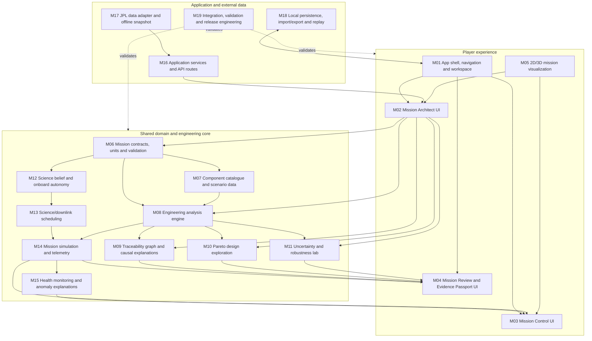
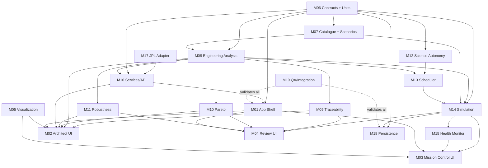

# MISSIONFORGE — Parallel Module Breakdown & AI-Agent Execution Plan

> **Purpose:** Split MISSIONFORGE into independently buildable modules with explicit ownership, interfaces, dependencies, deliverables, acceptance criteria, integration gates, and ready-to-use AI coding-agent prompts.
>
> **Companion documents:** `README.md`, `architecture.md`, `prod.md`, and `research_basis.md` are the source specifications. This file translates those specifications into an executable team plan. It does not replace the domain equations, research caveats, product requirements, or source policies in those documents.
>
> **Product principle:** Build one coherent end-to-end mission journey, not a collection of disconnected impressive features. Every module must contribute to the same canonical mission model and must be integrated into the playable path.

---

## 0. How to use this document

Use this document when creating GitHub issues, assigning team members, spawning AI coding agents, or deciding what can safely be built at the same time.

The recommended sequence is:

1. Assign one integration owner to protect the shared contracts and repository.
2. Agree and commit the **Interface Freeze v1** contracts in Section 4.
3. Create module branches or isolated worktrees using the ownership rules in Section 6.
4. Start parallel work only after each module's prerequisites are merged or represented by the approved mock fixtures.
5. Integrate through the gates in Section 9. Do not postpone integration until the end.
6. Keep every advanced feature behind a feature flag until its acceptance criteria pass.

### 0.1 Important implementation rule

**Python-first rule:** Python is the required language for the main software architecture and canonical domain/engineering systems. The browser app remains TypeScript, but it only consumes Python API results and must not reimplement mission physics or mission logic. FastAPI + Pydantic v2 define the backend API and shared contracts.

MISSIONFORGE is a **two-part application with one Python modular-monolith backend**: a Next.js/React/TypeScript frontend for presentation and a Python 3.12+/FastAPI backend for the main architecture. All authoritative mission models, engineering calculations, traceability, optimization, uncertainty, science belief/autonomy, scheduling, simulation, telemetry analysis and JPL adapters are Python modules. TypeScript must not duplicate this logic. Do not create separate backend microservices, service discovery, distributed queues, or a microservice fleet for the hackathon.

### 0.2 Priority labels

| Label | Meaning | Delivery rule |
|---|---|---|
| `P0 — Demo critical` | Without it the complete mission journey cannot be demonstrated | Must work end to end |
| `P1 — Differentiator` | Makes the project technically distinctive and materially strengthens judging | Build after P0 path is stable |
| `P2 — Enhancement` | Improves depth, polish, or learning value but is not required for a credible demo | Feature-flag; cut before destabilizing P0 |
| `P3 — Deferred` | Valuable future capability, too expensive or too easy to misrepresent in a hackathon | Do not start unless all core acceptance tests pass |

### 0.3 Fidelity labels used across every module

Every displayed metric, component parameter, and mission result must use the common fidelity model defined in `architecture.md`:

- `source-backed`: taken from a named, traceable public source or data provider.
- `derived`: calculated from explicit inputs using a documented equation or transformation.
- `gameplay-estimate`: simplified or illustrative value used for a playable experience.
- `not-modelled`: a real-world effect the application does not calculate.

A module is not complete if it creates technically plausible-looking values but hides their provenance or model limitations.

---

# 1. Product decomposition at a glance

MISSIONFORGE is divided into six product layers and nineteen implementation modules. Some modules can be owned by one person; others are bundles of tightly related tasks that a contributor can split between themselves and an AI agent.



## 1.1 Module priority summary

| ID | Module | Main owner | Priority | Can start when |
|---|---|---|---|---|
| M01 | App shell, navigation and workspace | Frontend/integration | P0 | Immediately, using stub data |
| M02 | Mission Architect UI | Frontend | P0 | Interface Freeze v1 + M01 shell |
| M03 | Mission Control UI | Frontend/simulation UI | P0 | Event and telemetry contracts agreed |
| M04 | Mission Review and Evidence Passport UI | Frontend/product | P0 | Run result and provenance contracts agreed |
| M05 | Mission visualization | Graphics/frontend | P1 | Scenario and trajectory view contracts agreed |
| M06 | Mission contracts, units and validation | Domain lead | P0 | Immediately; merge first |
| M07 | Component catalogue and scenario data | Data/domain | P0 | M06 quantity/provenance contracts agreed |
| M08 | Engineering analysis engine | Physics/domain | P0 | M06 + M07 fixtures |
| M09 | Traceability graph and causal explanations | Domain/product logic | P1 | M06 + M08 output contract |
| M10 | Pareto design exploration | Optimization | P1 | M08 stable input/output |
| M11 | Uncertainty and robustness lab | Modeling | P1 | M08 deterministic and pure |
| M12 | Science belief and onboard autonomy | Science/AI logic | P1 | Science objective and observation contracts agreed |
| M13 | Science/downlink scheduler | Operations algorithms | P1 | Data, power, opportunity and contact contracts agreed |
| M14 | Mission simulation and telemetry | Simulation/domain | P0 | M06 + M07 + M08 stable |
| M15 | Spacecraft health monitoring | Analytics/domain | P1 | M14 telemetry schema frozen |
| M16 | Application services and API routes | Full-stack/backend | P0 | M06 schemas and service contracts agreed |
| M17 | JPL adapter and offline data | Data/backend | P0 for asteroid live-data story; otherwise P1 | M06 provenance and normalized target contract |
| M18 | Persistence, import/export and replay | Frontend/platform | P0 | MissionState/run manifest contracts frozen |
| M19 | Integration, validation and release engineering | QA/integration owner | P0 | Starts immediately; expands throughout |

---

# 2. Recommended parallel team structure

The team should organize around ownership domains, not around pages alone. Each contributor owns a coherent lane and may use one or more AI agents as implementation assistants. A contributor remains accountable for reviewing generated code, running tests, and integrating the result.

## 2.1 Recommended six-lane allocation

| Lane | Human owner | Owns | Likely AI-agent support |
|---|---|---|---|
| A — Platform and integration | Tech lead | M01, M16, M19; protected contracts; branch integration | Scaffold, API route boilerplate, test harness |
| B — Mission engineering | Domain/physics lead | M06, M07, M08 | Equations, unit tests, catalogue validation |
| C — Mission design experience | Frontend lead | M02, M05, M18 | Components, form states, visualization shell |
| D — Mission operations | Simulation lead | M03, M14, M15 | Event engine, telemetry, deterministic scenarios |
| E — Research differentiators | Algorithms lead | M09, M10, M11, M12, M13 | Pareto, Monte Carlo, Bayesian update, scheduler |
| F — Product, data and story | Product/data lead | M04, M17, scenario narrative, research provenance, demo | JPL mapper, evidence dossier, acceptance tests |

**Flexible assignment:** If only four people are available, combine A+F, B+E, C, and D. If eight people are available, split M10/M11, M12/M13, and M17/M18 into separate owners. Do not assign two agents to the same source files at the same time.

## 2.2 Human ownership vs AI-agent execution

AI agents may implement code inside a module boundary, but they must not independently decide:

- Canonical mission data types or unit conventions.
- Whether a quantity is source-backed versus estimated.
- What a hard feasibility constraint means.
- How the mission score is weighted.
- Whether a physical model is sufficiently validated to be shown as a real engineering prediction.
- Which npm dependencies or versions are added to the project.
- Whether a module is allowed to bypass another module's API.

Those decisions belong to the relevant human owner and integration lead. An agent can propose changes with impact analysis and tests; it cannot silently modify shared contracts.

---

# 3. End-to-end vertical slice: build this before the advanced features

Before parallelizing every module, the team must establish one working player journey. This prevents the project from becoming a technically ambitious collection of disconnected pages.

## 3.1 Required first playable journey

```text
Open app
  → select NEO Rendezvous scenario
  → load initial MissionState
  → view 2 science objectives
  → select one instrument and one propulsion/power option
  → update live mass, power, data and delta-v analyses
  → see one clear warning and the reason for it
  → resolve the warning by changing a component
  → validate and baseline the design
  → run a seeded mission
  → view phase timeline and telemetry
  → resolve one anomaly decision
  → receive final science result and mission report
  → export the mission dossier
```

## 3.2 Vertical-slice acceptance checklist

- [ ] Scenario loads from versioned JSON, not hard-coded JSX objects.
- [ ] The saved design is a canonical `MissionState`.
- [ ] A single deterministic `analyzeMission()` call produces all visible budget metrics.
- [ ] At least one input edit changes at least two causally related outputs.
- [ ] A failed constraint includes an explanation and impacted subsystem IDs.
- [ ] The mission cannot start if required hard constraints fail, unless the player explicitly enters a documented risky/educational mode.
- [ ] The simulation is seeded and can be replayed.
- [ ] Mission events and telemetry are generated by the simulation engine, not independently fabricated by UI timers.
- [ ] The review view consumes the same immutable run result that Mission Control displayed.
- [ ] The export contains source, version and seed information.
- [ ] The full journey works with local demo data and no external network.

**Do not begin the full 3D scene, a large component catalogue, complex trajectory search, or LLM features before this journey works.**

---

# 4. Shared contracts: freeze before parallel development

The contracts in this section are a practical interface agreement derived from `architecture.md`. The architecture document remains authoritative for complete definitions and physical assumptions. The goal here is to give each module the same vocabulary and stop parallel agents inventing incompatible shapes.

## 4.1 Canonical contract owners

All listed canonical contracts are implemented in Python/Pydantic in `backend/app/schemas/` or the explicitly named Python domain model package. The frontend consumes generated TypeScript API types only; it does not own canonical mission or analysis models.

| Contract | Source of truth | Change approver |
|---|---|---|
| `MissionState` | `backend/app/schemas/mission.py` | Domain lead + integration lead |
| `Quantity`, `Unit`, `Provenance`, `Fidelity` | `backend/app/schemas/units.py` | Python domain lead |
| `CatalogComponent` and catalogue version | `backend/app/schemas/catalog.py` | Data/domain lead |
| `MissionAnalysis`, `ConstraintResult` | `backend/app/schemas/analysis.py` | Domain lead |
| `MissionEvent`, `TelemetrySample`, `MissionRun` | `backend/app/schemas/simulation.py` | Simulation lead + integration lead |
| `TrajectoryOption`, `SpaceDataStatus` | `backend/app/schemas/trajectory.py` or agreed shared file | Data lead + domain lead |
| `TradeStudyResult` | `backend/app/schemas/optimization.py` | Algorithms lead |
| `RobustnessReport` | `backend/app/schemas/uncertainty.py` | Algorithms lead |
| `ScienceBeliefState`, `ObservationOutcome` | `backend/app/schemas/science_belief.py` | Algorithms lead + product owner |
| `ObservationOpportunity`, `ContactWindow`, `MissionSchedule` | `backend/app/schemas/operations.py` | Operations algorithms owner |
| `EvidenceRecord`, `MissionRunManifest` | `backend/app/schemas/evidence.py` | Product/data lead + integration lead |
| `ApiResult` | `backend/app/schemas/api.py` | Backend/integration lead; frontend client types generated from OpenAPI |

Do not let two modules define the same concept with slightly different field names. Import the shared type or propose one explicit extension.

## 4.2 Core object contracts

### A. MissionState — editable design

`MissionState` is the single editable source of truth. It contains design choices, scenario, objectives, planned operations, limits, selected trajectory, and a random seed. It must **not** contain derived totals such as total mass, calculated power margin, score, or feasibility. Those belong in `MissionAnalysis`.

Key invariants:

- `schemaVersion` is present and validated.
- Every selected component ID resolves in the active catalogue version.
- Every science requirement has a stable ID.
- Every observation plan entry references a valid measurement requirement.
- Units are explicit in values or enforced by the typed quantity contract.
- A committed design edit increments `designRevision`.
- A component change cannot mutate an old immutable simulation run.

### B. MissionAnalysis — derived engineering state

Output of the pure analysis engine. At minimum it contains mass, power, data, delta-v, cost, science coverage, reliability/risk summary, constraints, feasibility, score preview, and top drivers.

Invariants:

- `missionId` and `designRevision` match the input.
- `engineVersion` and `catalogVersion` are recorded.
- It is safe to regenerate from the same MissionState.
- Every constraint has a status and user-readable explanation.
- `not-modelled` effects are not silently represented as pass.

### C. MissionRun — immutable simulation output

A mission run contains input snapshot reference, input design revision, run ID, seed, scenario event set ID, engine/catalogue versions, ordered events, telemetry checkpoints, phase transitions, decisions, science outcomes, and final report.

Invariants:

- A run references the exact MissionState revision used to create it.
- Run events are append-only after completion.
- Replay with the same input, versions and seed produces the same event sequence.
- UI animation speed must not influence simulation output.

### D. Provenance / EvidenceRecord — why should a player trust this value?

Every source-backed or derived number needs enough information to explain its origin. Evidence records should include:

- Stable evidence ID.
- Subject entity/parameter/result ID.
- Fidelity label.
- Source title and canonical URL when applicable.
- Source version or API signature when available.
- Retrieval or publication timestamp when available.
- Unit and conversion notes.
- Assumptions and limitations.
- Related analysis or event IDs.

### E. Service result envelope

All server routes use the shared `ApiResult` pattern from `architecture.md`. UI modules should use typed API-client functions rather than constructing endpoint-specific fetch code in components.

```python
from typing import Any, Generic, TypeVar
from pydantic import BaseModel

T = TypeVar("T")

class ApiMeta(BaseModel):
    request_id: str
    schema_version: str = "1.0"
    generated_at: str | None = None
    source_status: str | None = None

class ApiError(BaseModel):
    code: str
    message: str
    retryable: bool
    details: dict[str, Any] | None = None

class ApiResult(BaseModel, Generic[T]):
    ok: bool
    data: T | None = None
    error: ApiError | None = None
    meta: ApiMeta
```

## 4.3 Module input/output agreement

| Module | Primary inputs | Primary outputs | Side effects allowed? |
|---|---|---|---|
| M06 contracts | raw JSON, user draft | validated MissionState, unit-safe types | No |
| M07 catalogue | catalogue JSON, mission templates | validated catalogue + template list | Read-only at runtime |
| M08 analysis | MissionState + catalogue + scenario | MissionAnalysis | No |
| M09 traceability | MissionState + MissionAnalysis | graph + causal explanation records | No |
| M10 optimizer | MissionState + analysis engine + objective config | candidates + Pareto front + archetypes | No |
| M11 robustness | MissionState + analysis engine + uncertainty profile + seed | RobustnessReport | No mutation of input |
| M12 science autonomy | belief state + observation likelihood + policy | posterior + selected next action | No network/LLM |
| M13 scheduler | opportunities + contact windows + resource limits | mission schedule + rejected items | No |
| M14 simulator | MissionState + analysis + scenario event set + seed | immutable MissionRun | No external I/O |
| M15 health monitor | telemetry channels + thresholds | anomaly list + explanations | No |
| M17 JPL adapter | validated query parameters | normalized trajectory/target data | Server-side network and cache only |
| M18 persistence | MissionState + MissionRun + manifest | serialized save, export file, imported validated objects | Browser storage / file IO |
| M16 app service | validated requests + domain services | ApiResult | Route-level I/O only |

**Purity rule:** Modules M06–M15 are domain modules and should be deterministic/pure wherever technically practical. No React, browser storage, HTTP clients, timers, environment variables, or direct JPL calls inside Python domain algorithms.

## 4.4 Common naming conventions

- IDs: stable kebab-case strings, e.g. `neo-rendezvous`, `instrument-visible-camera-01`.
- Units: SI internally where practical; use the `Unit` union and explicit conversion functions at boundaries.
- Percentages: fractions `0..1` internally; convert to percent only in presentation.
- Time: ISO-8601 timestamps for wall-clock metadata; mission elapsed time in seconds or days with explicit units.
- Simulation ordering: integer event sequence number; timestamps may tie, sequence number breaks ties.
- Randomness: pass a seed into a deterministic PRNG; never call `unseeded random calls` in a domain module.
- Version fields: include schema, engine, catalogue, and scenario versions where applicable.

---

# 5. Module specifications

Each module below defines the boundary, ownership, files, prerequisites, work packages, interfaces, acceptance criteria, and coding-agent instruction. Start with P0 modules, then unlock differentiators once the vertical slice is passing.

## M01 — App shell, navigation and mission workspace

**Priority:** P0  
**Owner:** Platform/frontend lead  
**Primary files:** `frontend/src/app/**`, `frontend/src/components/shell/**`, `frontend/src/state/mission-store.ts`, `frontend/src/state/selectors.ts`, `frontend/src/lib/constants.ts`

### Objective

Create the stable application frame that allows a player to move between briefing, mission architecture, mission control, and mission review without losing the active mission context.

### Responsibilities

- Next.js layout, route groups and top-level navigation.
- Responsive app shell and design tokens.
- Mission workspace context: active mission ID, selected tab, current design revision, saved/dirty status.
- Route guards for missing mission/run IDs and not-found views.
- Global loading, error, offline, empty and WebGL-unavailable states.
- Mount points for feature modules; avoid implementing engineering logic here.

### Explicit non-responsibilities

- Do not calculate budgets.
- Do not define a second MissionState shape.
- Do not directly call JPL.
- Do not generate simulation events using UI timers.

### Prerequisites

- Can start immediately with typed mock objects.
- Must align route names with `architecture.md` and the pages in `README.md`.

### Deliverables

1. Landing / scenario-selection route.
2. Mission workspace shell with mission ID context.
3. Navigation to `/mission/[missionId]`, `/architect/[missionId]`, `/control/[runId]`, and `/review/[runId]`.
4. Empty and failure states.
5. Global visual tokens and component layout conventions.

### Acceptance criteria

- Direct navigation to each route works after refresh.
- Unknown mission/run IDs render a useful not-found state.
- The selected mission ID is not lost when moving between routes.
- Shell remains usable at common desktop and mobile widths.
- No feature module imports another feature's private UI components.

### AI-agent prompt

```text
Implement MISSIONFORGE M01: app shell, navigation and mission workspace.
Read README.md, architecture.md, prod.md and module_breakdown.md first.
Own only frontend/src/app/**, frontend/src/components/shell/** and the agreed shell-level state files.
Do not define or duplicate MissionState, MissionAnalysis or MissionRun.
Use typed mock repositories until M06/M18 are merged. Implement scenario entry,
mission workspace navigation, loading/error/empty/not-found states and responsive
layout. Do not add frontend packages or change `frontend/package.json`. Return a file list, screenshots
or route notes, tests run, and any contract questions.
```

---

## M02 — Mission Architect UI

**Priority:** P0  
**Owner:** Frontend lead  
**Primary files:** `frontend/src/components/mission-brief/**`, `frontend/src/components/science-traceability/**`, `frontend/src/components/architect/**`, `frontend/src/components/budgets/**`, `frontend/src/app/architect/**`

### Objective

Deliver the main design workspace where players translate a science brief into requirements and configure a spacecraft while seeing immediate, explainable consequences.

### Responsibilities

- Mission brief and objective editing.
- Requirement-to-instrument mapping presentation.
- Component selection controls for launch, bus, propulsion, EPS/power, ADCS, comms, C&DH, thermal and instruments.
- Live budget panels for mass, power/energy, delta-v, data/storage, cost and feasibility.
- Constraint status display and remediation suggestions.
- Design revision / unsaved state indicators.
- Show fidelity and source badges for all important values.
- Trigger analysis through a typed domain call or API-client function; never embed equations in React components.

### Primary interfaces

Consumes:

- `MissionState` and validated catalogue data.
- `MissionAnalysis`.
- Optional `TraceabilityGraph` from M09.
- Optional `TradeStudyResult` from M10.

Produces:

- A validated MissionState edit action, e.g. `selectComponent`, `updateObjective`, `updateConstraint`, `updateOperations`.
- A committed revision increment when design is saved/baselined.

### UI states that must exist

- Initial scenario with default component selections.
- Component unavailable or incompatible.
- Analysis calculating / stale result.
- Analysis failure with retry.
- Infeasible / marginal / feasible status.
- Value provenance popover.
- No source or no model available.
- Responsive narrow-screen layout.

### Acceptance criteria

- Changing a component updates the canonical design and re-runs analysis.
- Stale calculation results cannot overwrite analysis for a newer revision.
- A warning explains `actual`, `limit`, `margin`, impacted subsystem and at least one possible action when available.
- User can inspect why a required measurement is not covered.
- The UI never displays missing data as zero.
- The UI distinguishes hard failure from advisory warning and not-modelled.

### AI-agent prompt

```text
Implement MISSIONFORGE M02 Mission Architect UI only.
Read architecture.md sections 6–8 and 12, prod.md sections 8 and 13,
and module_breakdown.md. Own the architect feature components and page only.
Consume the canonical MissionState, CatalogComponent and MissionAnalysis contracts;
do not create local competing data models or calculate physical quantities in React.
Use mocks matching the exact contracts if the engine is not merged. Build objective
traceability, component selection, live budget panels, constraint explanations,
provenance affordances, loading/error/empty states, and keyboard-accessible controls.
Do not add dependencies or edit protected contracts. Add component tests where useful.
```

---

## M03 — Mission Control UI

**Priority:** P0  
**Owner:** Frontend/simulation UI  
**Primary files:** `frontend/src/components/mission-control/**`, `frontend/src/app/control/**`

### Objective

Make the mission operational experience understandable and visually compelling. Players must see mission phase, telemetry, events, constraints, science progress and decisions as consequences of the simulation engine.

### Responsibilities

- Mission phase header and elapsed-time display.
- Event timeline and filterable event log.
- Telemetry cards and trend charts.
- Decision cards for anomaly or autonomy choices.
- Mission pause/advance controls if supported by the discrete-event model.
- Blackout indicator and ground/onboard decision authority.
- Science progress and data buffer indicators.

### Input contracts

- `MissionRun` / run snapshot.
- Ordered `MissionEvent[]`.
- `TelemetrySample[]` or channel-indexed telemetry.
- `MissionSchedule` if the operations scheduler is enabled.
- `Anomaly[]` from M15.

### Important rule

The UI may animate the progression of an already-computed or incrementally advanced simulation, but it cannot independently invent telemetry. The event engine owns event order and state transitions. UI “speed up” changes playback speed, not physics or mission outcome.

### Acceptance criteria

- Every displayed event has a stable ID, mission time, severity/type and explanation.
- Telemetry charts use a consistent time basis and explicit units.
- A blackout state makes the current command authority obvious.
- Player decisions are recorded in the run log and reflected in the final report.
- Playback at 0.5×, 1× or 4× does not change the output sequence.
- UI shows a usable 2D fallback if the 3D scene is unavailable.

### AI-agent prompt

```text
Implement MISSIONFORGE M03 Mission Control UI.
Read the simulation, event, telemetry and autonomy contracts in architecture.md
and module_breakdown.md. Own only mission-control feature components and route UI.
Consume immutable event/telemetry data from M14; do not generate fake telemetry,
random anomalies or mission outcomes in components. Implement mission phase,
telemetry views, event log, decision cards, communication blackout status, science
progress, loading/error states and responsive 2D fallback. UI playback speed must
not affect deterministic simulation results. Do not modify simulation contracts.
```

---

## M04 — Mission Review and Evidence Passport UI

**Priority:** P0  
**Owner:** Product/frontend or product/data lead  
**Primary files:** `frontend/src/components/review/**`, `backend/app/domain/evidence/**`, `frontend/src/app/review/**`

### Objective

Turn the mission into a learning and trust experience. The player should understand what the mission achieved, which objectives were met, what failed, why it failed, and which inputs and assumptions produced the report.

### Responsibilities

- Mission result summary: success class, science return, hard constraints, risk events and resource margins.
- Objective-by-objective science return and missing measurement explanation.
- Compare baseline design vs flown design if anomaly choices changed operations.
- Counterfactual recommendations: “If you had selected X, then metric Y would have changed by Z” only when calculated by a deterministic analysis, not invented prose.
- Mission Evidence Passport export (JSON and printable report/HTML; PDF can be deferred).
- Show JPL/source attribution, catalogue and engine versions, scenario version, seed and model assumptions.

### Primary interfaces

Input: immutable `MissionRun`, `MissionState` snapshot, `MissionAnalysis`, `EvidenceRecord[]`, optional `TradeStudyResult` and `RobustnessReport`.

Output: presentation model and export artifact. Evidence records must be traceable to stable entity IDs and result IDs.

### Acceptance criteria

- The same run always produces the same factual report.
- The report contains engine, catalogue, scenario and seed metadata.
- Every externally sourced value includes a source link or an explicit unavailable-source label.
- The player can identify at least one successful objective and one shortfall (or a clear “all met” result).
- The report distinguishes a failed mission from an incomplete model.
- Exported JSON re-imports and validates.

### AI-agent prompt

```text
Implement MISSIONFORGE M04 Mission Review and Evidence Passport.
Read prod.md review/acceptance sections, architecture.md provenance/run contracts,
and module_breakdown.md. Own review UI and evidence/dossier presentation only.
Consume canonical MissionRun, MissionAnalysis, EvidenceRecord and version metadata.
Do not invent source citations, mission metrics or counterfactual improvements.
Every conclusion must point to a run result, analysis field, event ID or explicit
assumption. Build review summary, science outcome breakdown, anomaly explanation,
source/assumption ledger and JSON export. PDF export is optional and must not block
JSON export or the playable journey.
```

---

## M05 — Mission visualization (2D first, 3D selectively)

**Priority:** P1  
**Owner:** Graphics/frontend contributor  
**Primary files:** `frontend/src/components/scene/**`, `frontend/src/components/visualization/**`, `frontend/src/lib/scene/**`

### Objective

Provide memorable visual context for spacecraft, target body, trajectory options, mission phase and events without pretending a stylized scene is a high-fidelity astrodynamics solver.

### Responsibilities

- 2D orbit/trajectory diagram as the required baseline.
- Optional Three.js / React Three Fiber solar-system scene, loaded lazily.
- Spacecraft and target-body models or lightweight procedural geometry.
- Camera presets: overview, target approach, spacecraft close-up.
- Visual event markers for trajectory legs and mission phases.
- Accessible textual equivalents and non-WebGL fallback.

### Fidelity boundary

Visual position is only as accurate as the trajectory/scenario input. A stylized interpolated path is a **visualization**, not a propagated ephemeris. If the scene uses normalized coordinates or exaggerated distances, disclose that in an “illustrative scale” note.

### Acceptance criteria

- The mission remains completely playable with WebGL disabled.
- Visuals use the active scenario/trajectory data; no hard-coded unrelated orbit is displayed.
- Scene labels include target and phase names.
- The browser does not load the 3D bundle on the first landing screen.
- Reduced-motion preference is respected.
- Frame-rate degradation does not change mission calculations.

### AI-agent prompt

```text
Implement MISSIONFORGE M05 mission visualization. Deliver 2D fallback first,
then optional lazy-loaded 3D scene if time allows. Read architecture.md visual/fidelity
rules and module_breakdown.md. Consume normalized trajectory/scenario/mission-phase
inputs. Do not implement orbital propagation or invent coordinates inside the scene.
Clearly label stylized scale and interpolated paths. Keep scene components isolated,
provide accessible textual equivalents, respect reduced motion, and ensure the
application works if WebGL is absent. Do not add a large asset pipeline.
```

---

## M06 — Mission contracts, units, validation and schema versioning

**Priority:** P0, merge first  
**Owner:** Python domain lead / backend integration lead  
**Primary files:** `backend/app/domain/units/**`, `backend/app/domain/mission/**`, `backend/app/schemas/api.py`

### Objective

Establish the shared language of the system. This is the most important coordination module because every other module depends on it.

### Responsibilities

- Define `Fidelity`, `Unit`, `Provenance`, `Quantity` and uncertainty metadata.
- Implement explicit unit conversion helpers and guards.
- Define canonical `MissionState` and related science/operation types.
- Define Pydantic v2 models for canonical validation and FastAPI request/response schemas.
- Define mission defaults and schema migration strategy.
- Define validation error structure.
- Define stable ID and design-revision conventions.

### Required files

```text
backend/app/schemas/units.py
backend/app/domain/units/conversions.py
backend/app/domain/units/guards.py
backend/app/schemas/mission.py
backend/app/schemas/trajectory.py
backend/app/domain/mission/defaults.py
backend/app/domain/mission/traceability.py
backend/app/schemas/api.py
```

### Required validation checks

- Valid schema version and supported scenario ID.
- Numeric fields are finite and within reasonable configured bounds.
- Component IDs and measurement references are syntactically valid.
- Duty cycles and fractions lie in `[0, 1]` where specified.
- Dates parse and order correctly.
- No duplicate stable IDs in arrays that require uniqueness.
- No `NaN`, positive/negative infinity, or implicit string-to-number coercion.
- Provenance and unit fields exist where required.

### Deliverables

1. Shared Python/Pydantic models as the canonical contracts; generate TypeScript API types from FastAPI OpenAPI.
2. Runtime schemas and parsing helpers.
3. Unit conversion helpers with known-answer tests.
4. One valid default MissionState per scenario or one fixture until all scenarios are ready.
5. Contract documentation and versioning note.

### Acceptance criteria

- All other modules import these contracts rather than defining alternatives.
- Invalid payloads return structured validation errors.
- Unit conversions have tests for km↔m, km/s↔m/s, Wh↔J, dB-related conversions where appropriate, and time units.
- The default MissionState parses and validates.
- MissionState does not contain derived analysis totals.
- Schema version is present in saved and exported mission data.

### AI-agent prompt

```text
Implement MISSIONFORGE M06 shared mission contracts. This is a protected foundation.
Read the canonical contracts in architecture.md §6 and this module plan §4.
Own only units, mission types/schemas/defaults and API result types. Preserve the
specified MissionState concept; do not add derived totals to editable state.
Use explicit units, finite-number validation, stable IDs and schemaVersion.
Add conversion tests and at least one valid default fixture. Do not add dependencies
without approval. Before changing a shared concept, report the proposed change,
all affected modules and migration impact. Do not build UI or engine calculations.
```

---

## M07 — Component catalogue, mission templates and data validation

**Priority:** P0  
**Owner:** Data/domain lead  
**Primary files:** `data/catalog/**`, `data/missions/**`, `backend/app/domain/catalog/**`, `backend/scripts/validate_catalog.py`

### Objective

Provide a compact, internally consistent component and scenario dataset that powers the whole experience. The catalogue is not a shopping list; it is a set of engineering archetypes with explicit parameters, compatibility and evidence.

### Responsibilities

- Versioned JSON component catalogue for launch, bus, propulsion, power, ADCS, communications, thermal, C&DH, instruments and ground segment.
- Mission scenario templates: NEO Rendezvous, Lunar Polar Scout and Earth Observation.
- Component compatibility constraints and failure-mode metadata.
- Provenance/fidelity records for each numerical parameter.
- Catalogue schema validation and cross-reference checks.
- Curated offline JPL snapshot metadata, coordinated with M17.

### Scope discipline

For the hackathon MVP, prefer 3–5 credible options per critical category over dozens of thinly documented records. Use clearly named illustrative archetypes where exact public data is unavailable. No component should have an invented manufacturer or be presented as a flight-qualified product.

### Data rules

- Use stable component IDs.
- Record source for each important engineering parameter, not only at the component level when source quality differs.
- Mark assumed values as `gameplay-estimate`.
- Store native unit and conversion assumptions.
- Avoid conflicting masses, power draws or interfaces across records.
- Model compatibility as explicit rules, not front-end visibility hacks.

### Acceptance criteria

- Every component JSON validates against `CatalogComponent` schema.
- Every MissionState component ID resolves.
- All values are finite and have units/provenance.
- A catalogue validation script runs in CI.
- At least one component swap produces a meaningful difference in the analysis engine.
- Demo works without a live external API.

### AI-agent prompt

```text
Implement MISSIONFORGE M07 catalogue and scenario data. Read architecture.md §§6–7,
README.md data policy and module_breakdown.md. Own only data/catalog, data/missions,
catalog loader and validation script. Build a small coherent catalogue with explicit
units, provenance, fidelity and compatibility rules. Do not invent real vendors or
flight-qualified specifications. Mark illustrative archetypes clearly. Ensure every
scenario template resolves all component IDs and required measurements. Add a
validation command that exits non-zero on invalid schema or broken references.
Do not implement analysis formulas or UI.
```

---

## M08 — Engineering analysis engine

**Priority:** P0, central domain module  
**Owner:** Mission engineering / physics lead  
**Primary files:** `backend/app/domain/analysis/**`, `backend/tests/unit/analysis/**`

### Objective

Calculate coupled mission budgets from MissionState and catalogue data through deterministic, transparent, independently testable pure functions.

### Submodules

| Submodule | Responsibility | Main outputs |
|---|---|---|
| Mass | payload, bus, subsystem, propellant and margin accounting | dry/wet/allocated mass, margin |
| Propulsion | rocket equation and maneuver budget | available delta-v, required delta-v, margin |
| Power | peak/average power and phase energy ledger | load, generation, SOC/energy margin |
| Communications | simplified RF link budget | link margin by contact |
| Data | generated/downlinked bits and buffer | backlog, storage overflow risk |
| Thermal | allowed-temperature-band and exposure checks | qualitative warning/not-modelled status |
| Orbital | scenario-specific educational orbital calculations | period/velocity/trajectory context where supported |
| Cost | transparent component/mission estimate | cost total and breakdown |
| Reliability | component failure modes / qualitative risk proxy | nominal reliability and risk index |
| Science | measurement coverage by payload and observation plan | weighted objective coverage |
| Constraints | apply configured hard/advisory limits | `ConstraintResult[]` |
| Score | explainable 0–100 score preview | score breakdown |
| Orchestrator | call modules, compose stable output | `MissionAnalysis` |

### Build order inside M08

1. Types and validation fixtures from M06/M07.
2. Mass and propulsion.
3. Power and energy.
4. Data and communications.
5. Science coverage and compatibility.
6. Cost, reliability and thermal flags.
7. Constraint aggregation and score.
8. Top-driver and explanation output.
9. `analyzeMission()` orchestrator.

### Non-negotiable modeling constraints

- Do not add C3 directly to spacecraft delta-v.
- Keep launch energy and onboard propulsion maneuver budget distinct.
- Distinguish W from Wh/J.
- Distinguish generated data from downlinked data and enforce buffer capacity.
- Do not double-count structure already included in bus mass.
- Do not label Tier 2 or not-modelled values as a validated physical prediction.
- Keep formulas and assumptions near the model implementation and in tests.
- Avoid artificial precision; round only for display.

### Acceptance criteria

- Each discipline has normal, edge and invalid-input tests.
- Hand-calculation test vectors match within defined tolerance.
- Same MissionState/catalogue/scenario produces same analysis excluding explicit `calculatedAt` metadata.
- The engine returns structured errors or constraint states, not `NaN`/`Infinity`.
- Every major result has source/provenance/fidelity and assumptions.
- `analyzeMission()` meets the performance target in `architecture.md` for a typical mission.
- A component change has visible, causally correct effects in at least two relevant metrics.

### AI-agent prompt

```text
Implement MISSIONFORGE M08 engineering analysis engine.
Read architecture.md §§6–8 and the model equations carefully, research_basis.md,
and module_breakdown.md. Own backend/app/domain/analysis/** and its tests only.
Use canonical MissionState, CatalogComponent, Quantity and MissionAnalysis types.
Implement pure deterministic discipline functions and compose analyzeMission().
Explicitly separate C3, V-infinity and onboard delta-v; separate W from Wh; enforce
mass, power, buffer, link and compatibility constraints. No React, fetch, timers,
unseeded Python randomness or external AI calls. Return named assumptions and provenance. Add
known-answer fixtures and invalid-input tests. Do not quietly simplify a formula
without documenting the fidelity limitation.
```

---

## M09 — Traceability graph and causal explanation engine

**Priority:** P1  
**Owner:** Domain/product logic  
**Primary files:** `backend/app/domain/traceability/**`, `backend/app/domain/explanation/**`, `backend/tests/unit/traceability/**`

### Objective

Create the visible causal chain from science objective to requirements, instruments, subsystem choices, analysis metrics, constraints and returned science. This is one of the most understandable ways to show judges the system's engineering depth.

### Responsibilities

- Build a directed graph from canonical entities and analysis outputs.
- Represent nodes and edges with stable IDs and types.
- Identify uncovered science requirements and orphan components.
- Identify which mission metrics are affected by a component or plan edit.
- Generate explainable “because” chains for constraints.
- Generate simple mission traceability matrix (MTM) / science traceability matrix (STM) views.

### Suggested graph contract

```python
from typing import Literal
from pydantic import BaseModel

TraceNodeType = Literal[
    "science-objective", "measurement", "instrument", "subsystem",
    "mission-metric", "constraint", "mission-event", "science-result",
]

class TraceNode(BaseModel):
    id: str
    type: TraceNodeType
    label: str
    entity_id: str
    status: Literal["covered", "partial", "uncovered", "pass", "warning", "fail"] | None = None

class TraceEdge(BaseModel):
    id: str
    from_id: str
    to_id: str
    relation: Literal["measured-by", "depends-on", "consumes", "constrains", "causes", "supports", "returns"]
    explanation: str | None = None
```

### Example causal path

```text
Science objective: characterize surface composition
  → measurement: spectral bands observed at required resolution
    → instrument: compact spectrometer
      → subsystem dependencies: pointing stability + power + storage
        → derived metrics: energy margin + data backlog + coverage
          → constraint: storage buffer exceeded before downlink window
            → explanation: observing duty cycle generates more bits than the next contact can transmit
```

### Acceptance criteria

- Every science objective can be traced to one or more measurement requirements.
- Every covered requirement resolves to at least one capable instrument.
- Every constraint explanation includes a valid path to its impacted subsystem or metric.
- Graph generation is deterministic and does not mutate MissionState.
- No graph edge references a missing node.
- UI can render the graph as a matrix or compact dependency explorer without graph layout logic in the domain module.

### AI-agent prompt

```text
Implement MISSIONFORGE M09 traceability and causal explanation engine.
Read architecture.md §§19.1 and 20, prod.md science traceability requirements,
and module_breakdown.md. Own traceability/explanation domain files and tests only.
Generate stable graph nodes/edges from canonical MissionState and MissionAnalysis.
Implement coverage checks, orphan detection, impact paths and constraint explanations.
Do not calculate engineering budgets; consume the engine output. Keep output
serializable and UI-independent. Add tests for uncovered requirement, component
removal, data-rate change propagation, stable IDs and graph referential integrity.
```

---

## M10 — Mission Design Arena: candidate generation and Pareto optimization

**Priority:** P1  
**Owner:** Algorithms/optimization lead  
**Primary files:** `backend/app/domain/optimization/**`, `backend/tests/unit/optimization/**`

### Objective

Generate and compare alternative feasible mission architectures so the application can explain that “best” depends on objectives and constraints.

### Responsibilities

- Generate a bounded set of candidate designs from approved component swaps / option combinations.
- Reuse `analyzeMission()`; never create a second physics engine.
- Filter hard-infeasible candidates.
- Normalize objective direction and units.
- Calculate non-dominated Pareto frontier.
- Select named archetypes such as Lean, Science-max and Resilient based on explicit objective weights and constraints.
- Explain why a candidate is on the frontier and what trade-off it makes.

### MVP algorithm

- Generate 50–250 candidates from controlled mutations, not unrestricted brute force.
- Use deterministic seed and stable candidate IDs.
- Use O(n²) dominance filtering; the scale is intentionally small.
- Defer NSGA-II, genetic algorithms and large search unless the core candidate set is already reliable.

### Acceptance criteria

- A dominates B only if it is no worse in every normalized objective and strictly better in at least one.
- Infeasible candidates are never shown as recommended feasible designs.
- Two identical candidates do not dominate each other.
- Same input + catalogue + seed produces same frontier and archetype selection.
- Archetype labels correspond to verifiable objective differences.
- UI can show why a design is selected and what is sacrificed.

### AI-agent prompt

```text
Implement MISSIONFORGE M10 Pareto Mission Design Arena.
Read architecture.md §§8 and 19.2, research_basis.md Pareto/architecture sections,
and module_breakdown.md. Own backend/app/domain/optimization/** and tests only.
Use analyzeMission() as the sole evaluator. Generate a bounded, seeded candidate
set using explicit allowed mutations; filter hard-infeasible candidates; normalize
objective directions; implement deterministic Pareto dominance and select Lean,
Science-max and Resilient archetypes. Include reason fields. Do not add NSGA-II or
new physics equations. Do not use unseeded random calls. Add dominance and determinism tests.
```

---

## M11 — Robustness Lab and uncertainty propagation

**Priority:** P1  
**Owner:** Modeling/statistics lead  
**Primary files:** `backend/app/domain/uncertainty/**`, `backend/tests/unit/uncertainty/**`

### Objective

Show whether a mission design remains feasible under uncertainty instead of only reporting a nominal point estimate.

### Responsibilities

- Define validated uncertainty profiles for selected catalogue/mission parameters.
- Support bounded normal, uniform, triangular and interval distributions where appropriate.
- Distinguish aleatory variability from epistemic uncertainty in report language.
- Use the canonical engine to evaluate each seeded sample.
- Report empirical feasibility fraction, Wilson interval, p10/median/p90 for selected outputs, and counts by failure cause.
- Preserve sample seed and profile version.

### Safety/fidelity boundary

This is an educational robustness experiment, not a flight-qualified risk certification. Do not call the feasibility fraction “mission reliability” unless the event model and statistical interpretation actually justify that term. Do not claim correlated uncertainty if the implementation samples variables independently.

### Acceptance criteria

- All samplers validate their bounds and finite parameters.
- Same seed and profile produce identical samples and report.
- A zero-success sample set returns valid zero with a correct interval, never `NaN`.
- Report includes N samples and uncertainty interval.
- Each failure count maps to a specific constraint or event class.
- Input MissionState is never mutated.

### AI-agent prompt

```text
Implement MISSIONFORGE M11 Robustness Lab.
Read architecture.md §19.3 and §21, research_basis.md uncertainty sources,
and module_breakdown.md. Own backend/app/domain/uncertainty/** and tests only.
Implement validated seeded samplers for normal, uniform, triangular and interval
profiles; run the canonical deterministic mission engine for each sample; report
feasibility fraction, Wilson interval, p10/median/p90, failure counts and seeds.
Label assumptions and distinguish epistemic from aleatory uncertainty. Do not
claim flight-qualified reliability or invent correlated samples. Never mutate input.
Add independent known-answer statistical tests.
```

---

## M12 — Science Hypothesis Tracker and onboard autonomy

**Priority:** P1  
**Owner:** Science algorithms lead  
**Primary files:** `backend/app/domain/science_belief/**`, `backend/app/domain/autonomy/**`, `backend/tests/unit/science_belief/**`

### Objective

Make scientific discovery an active part of gameplay. Observations should update a small set of hypotheses, and the onboard policy should choose the next measurement during communication blackout.

### Responsibilities

- Define scenario-level hypothesis set and prior probabilities.
- Define observation outcome likelihood tables, explicitly synthetic/gameplay-estimate where not sourced.
- Implement Bayesian posterior update.
- Calculate Shannon entropy and expected information gain for candidate measurements.
- Score candidate actions against science value, energy, data volume, time and safety constraints.
- Implement three fixed, explainable policies: conservative, balanced and science-seeking.
- Enforce command authority: during blackout, ground commands are unavailable; onboard policy acts using available local state.
- Log selected action and decision rationale.

### Scope boundary

The MVP is a small, discrete belief-state planner—not a general POMDP solver, reinforcement-learning agent or LLM-controlled spacecraft. The system must be deterministic and explain the reason for each action.

### Acceptance criteria

- Posterior probabilities sum to 1 within numerical tolerance.
- A more likely observation under hypothesis H increases H's posterior relative to other hypotheses.
- Expected information gain is non-negative within numerical tolerance for a valid model.
- No action is selected if it violates hard energy, storage, pointing or safety constraints.
- Blackout mode rejects ground-command decisions.
- Same belief state, candidate observations, policy and seed produce same choice.
- UI can show prior → observation → posterior → selected next action.

### AI-agent prompt

```text
Implement MISSIONFORGE M12 Science Hypothesis Tracker and onboard autonomy.
Read architecture.md §§19.4–19.5 and research_basis.md belief-state/autonomy papers.
Own science_belief and autonomy domain folders only. This is a bounded educational
belief-state model, not a full POMDP. Implement validated Bayesian updates, normalized
posteriors, entropy, expected information gain and three deterministic policies.
Candidate actions must respect resource/safety constraints. During blackout, reject
Earth-originated commands and explain onboard choice. Keep likelihood tables and
scenario truth explicitly labelled. No network, React, LLM or unseeded randomness. Test
posterior normalization, likelihood direction, information gain and blackout rules.
```

---

## M13 — Integrated science collection and downlink scheduler

**Priority:** P1  
**Owner:** Operations algorithms lead  
**Primary files:** `backend/app/domain/operations/**`, `backend/tests/unit/operations/**`

### Objective

Plan observation windows and communications contacts together so the spacecraft does not collect more data than its storage and downlink opportunities can safely support.

### Responsibilities

- Represent observation opportunities, instrument duration, priority and resource demands.
- Represent communication contact windows, bit rate, duration and availability.
- Enforce power, storage, instrument compatibility and timeline constraints.
- Select a feasible schedule using deterministic greedy priority and tie-breaking for MVP.
- Calculate data buffer evolution over mission time.
- Explain rejected observation opportunities and scheduling conflicts.
- Provide a schedule to the simulator and Mission Control UI.

### MVP scheduling approach

Use a transparent greedy scheduler:

1. Sort candidate opportunities by priority, then expected science gain, then start time, then stable ID.
2. Check instrument availability and conflict windows.
3. Check energy and pointing constraints from the opportunity record.
4. Simulate data generated and downlink capacity in chronological order.
5. Reject or defer opportunities that would overflow the buffer before the next contact.
6. Return all accepted/rejected decisions with reasons.

This is a heuristic schedule, not a globally optimal operations research solution. State that in the UI and report.

### Acceptance criteria

- Buffer never exceeds storage without an explicit data-loss event.
- Downlinked bits never exceed contact capacity or buffered bits.
- No overlapping use of a single instrument if it cannot operate concurrently.
- Schedule is deterministic for identical inputs.
- Rejected opportunities include a reason code.
- Every observation has a trace to a science requirement.

### AI-agent prompt

```text
Implement MISSIONFORGE M13 science/downlink scheduler.
Read architecture.md §19.6 and §21, product acceptance criteria, and this module plan.
Own backend/app/domain/operations/** and tests only. Use agreed ObservationOpportunity,
ContactWindow and resource contracts. Implement deterministic chronological greedy
scheduling with stable tie-breaks; enforce instrument conflicts, energy, contact
capacity and storage buffer. Return accepted and rejected opportunities with reason
codes and buffer timeline. Do not claim global optimality. Do not use unseeded Python randomness,
React or network I/O. Include tests for buffer overflow, contact capacity, conflict
handling, deterministic output and valid science traceability.
```

---

## M14 — Mission simulation, event engine and telemetry generation

**Priority:** P0  
**Owner:** Simulation/domain lead  
**Primary files:** `backend/app/domain/simulation/**`, `backend/tests/unit/simulation/**`

### Objective

Turn a feasible design and operations plan into a repeatable mission experience with phases, events, telemetry, anomalies, player choices and science outcomes.

### Responsibilities

- Seeded PRNG in `prng.py`.
- Mission phase state machine.
- Discrete-event timeline with deterministic ordering.
- Scenario event set and anomaly injection.
- Telemetry checkpoint generation linked to modeled subsystem states.
- Decision event and player choice capture.
- Science return calculation from planned/realized observations.
- Immutable run manifest and event log.

### Mission phases for MVP

1. Launch and deployment.
2. Commissioning.
3. Cruise / transfer.
4. Target approach.
5. Science operations.
6. Downlink and data return.
7. Mission complete / early termination.

### Event model

Events should be typed, ordered and explainable. Examples: phase transition, propulsion burn, instrument observation, contact begins/ends, buffer warning, power low, anomaly detected, safe mode, player decision, onboard autonomy action, data downlink, science result.

### Important separation

- The simulation engine computes event order and mission state.
- The UI determines how quickly the player watches the event stream.
- Wall-clock timers are not part of simulation truth.
- Any random event is generated from the provided seed and explicit scenario event configuration.

### Acceptance criteria

- Same MissionState + engine/catalogue/scenario versions + seed returns the same run.
- Run stores the exact design revision and input snapshot reference.
- Events are sorted deterministically, including same-time tie-breaking.
- Telemetry is generated from modeled state or clearly marked synthetic for demonstration.
- Player choices are present in the final event log.
- Simulation cannot silently bypass hard launch constraints.
- Tests cover a nominal run, at least one anomaly, a decision branch and early termination.

### AI-agent prompt

```text
Implement MISSIONFORGE M14 deterministic mission simulation.
Read architecture.md §9 and extended science/autonomy/scheduling sections, prod.md
mission-control acceptance criteria, and module_breakdown.md. Own backend/app/domain/simulation/**
and its tests. Implement seeded PRNG, mission phase state machine, typed events,
telemetry checkpoints, anomaly events, decision logging and immutable MissionRun.
Consume MissionAnalysis and operations schedule; do not duplicate engineering formulas.
Simulation must not depend on browser timers, UI playback speed, fetch, or unseeded Python randomness.
Add golden deterministic fixtures for nominal, anomaly, decision and abort paths.
```

---

## M15 — Spacecraft health monitoring and anomaly explanation

**Priority:** P1  
**Owner:** Analytics/domain lead  
**Primary files:** `backend/app/domain/health_monitor/**`, `backend/tests/unit/health_monitor/**`

### Objective

Interpret telemetry deviations and connect them to operational explanations, enabling the player to see how a spacecraft detects and responds to abnormal behaviour.

### Responsibilities

- Define canonical telemetry channel metadata: name, unit, expected range, critical threshold and persistence rule.
- Implement EWMA or simple rolling-baseline anomaly detection.
- Implement threshold persistence / hysteresis to reduce noise.
- Classify severity and identify possible affected subsystem IDs.
- Produce readable evidence-based explanation: observed value, baseline, threshold, duration and potential implication.
- Connect detected anomaly to scenario events and decision prompts.

### Scope boundary

Do not claim a trained flight-qualified anomaly detector. The MVP uses simple, explainable statistical rules on synthetic/gameplay telemetry. If a machine-learning detector is explored, it must be an optional comparison and must not replace the transparent baseline.

### Acceptance criteria

- A single non-critical spike does not become a critical anomaly unless a hard threshold is crossed.
- Threshold persistence and hysteresis are configurable and tested.
- Each anomaly maps to telemetry channel and time window.
- False-positive and true-positive teaching scenarios exist.
- Same telemetry input and detector config produce same anomaly set.

### AI-agent prompt

```text
Implement MISSIONFORGE M15 spacecraft health monitor.
Read architecture.md §19.7 and module_breakdown.md. Own health_monitor domain files
and tests only. Implement explainable EWMA/rolling baseline, threshold persistence,
hysteresis and anomaly severity. Consume telemetry samples from M14; do not generate
telemetry or change mission state. Every anomaly must include channel, unit, observed
value, baseline, threshold, window, severity and affected subsystem candidates.
Label this as an educational detector, not flight-qualified fault diagnosis. Add
spike, persistent drift, hard-limit and no-anomaly tests.
```

---

## M16 — Python application services, FastAPI routes and frontend API client

**Priority:** P0  
**Owner:** Python backend lead  
**Primary files:** `backend/app/services/**`, `backend/app/api/routes/**`, `frontend/src/lib/api-client.ts`

### Objective

Provide a small validated application boundary between browser features and domain/server capabilities.

### Responsibilities

- FastAPI route handlers with Pydantic v2 request/response validation.
- Stable `ApiResult` envelopes and error mapping.
- Mission application service orchestration.
- Catalogue/template retrieval.
- Mission validation/trade-study/simulation calls.
- JPL data service integration through M17.
- Health endpoint with app/engine/catalogue versions.
- Typed browser API client wrapper.

### MVP routes

- `GET /api/catalog`
- `GET /api/templates`
- `POST /api/mission/validate`
- `POST /api/mission/trade-study`
- `POST /api/mission/simulate`
- `GET /api/space-data/neo-accessible`
- `GET /api/space-data/neo/[designation]`
- `GET /api/health`

Advanced endpoints for optimizer, robustness and scheduler may be exposed as FastAPI routes when the UI needs them. The algorithms always execute in Python domain modules; do not implement them in Web Workers or duplicate them in TypeScript.

### Acceptance criteria

- Invalid requests fail with structured validation errors.
- Domain errors map to stable API error codes.
- Browser never calls JPL directly.
- Server routes never return raw upstream JPL payloads.
- No endpoint exposes environment variables or secrets.
- Integration tests cover success, validation error, offline JPL fallback and unexpected error.

### AI-agent prompt

```text
Implement MISSIONFORGE M16 in Python.
Read architecture.md §§5 and 11 and module_breakdown.md. Own `backend/app/services/**`,
`backend/app/api/routes/**` and `backend/app/schemas/**`. Implement FastAPI routes with
Pydantic v2 validation and the canonical ApiResult response envelope. Generate the
OpenAPI schema so the frontend API client can derive its TypeScript types from it.
Call Python domain modules as pure functions. Use the M17 repository for JPL data;
never fetch JPL from browser code or expose raw upstream responses. Map all errors
to documented codes. Do not put engineering equations in route handlers. Do not add
authentication, a database or microservices. Add route-level integration tests.
```

---

## M17 — JPL Small-Body Mission Design adapter and resilient demo data

**Priority:** P0 for asteroid-data differentiator; P1 if time constrained  
**Owner:** Python backend/data lead  
**Primary files:** `backend/app/integrations/jpl/**`, `backend/app/infrastructure/cache/**`, `backend/app/infrastructure/queue/**`, `public/data/demo-jpl-snapshot.json`, `backend/scripts/capture_demo_data.py`

### Objective

Use authentic small-body mission design information responsibly while keeping the application robust when the external service is unavailable.

### Responsibilities

- Typed JPL client for supported mission design modes.
- Server-only request logic and application-specific User-Agent.
- Serialized request queue (concurrency one).
- Timeout, retry/backoff and response-version checks.
- Normalize field/record arrays into typed trajectory records.
- Cache live responses with documented TTL and stale fallback.
- Maintain a captured demo snapshot with retrieval/source metadata.
- Return source status: live, cached or demo.

### Explicit non-responsibilities

- Do not create browser-to-JPL fetch logic.
- Do not expose an arbitrary URL proxy.
- Do not silently parse unknown API versions.
- Do not create a new astrodynamics propagation engine.
- Do not imply JPL supplied values are spacecraft subsystem performance.

### Acceptance criteria

- Browser network inspection shows calls only to MISSIONFORGE endpoints.
- Requests are serialized and cacheable.
- User-Agent includes product name, version and contact metadata.
- Response `signature.version` is checked.
- Unsupported schema produces a safe fallback/error status.
- Offline/demo snapshot contains source link, capture date, source version and fidelity.
- UI visibly distinguishes live, cached and demo data.

### AI-agent prompt

```text
Implement MISSIONFORGE M17 JPL Small-Body Mission Design adapter.
Read architecture.md §10 and README.md external-data rules. Own
`backend/app/integrations/jpl/**`, `backend/app/infrastructure/cache/**`,
`backend/app/infrastructure/queue/**` and Python demo snapshot capture/validation
scripts only. Implement the adapter in Python; the browser must never call JPL. Implement
server-side typed requests, app-specific User-Agent, serialized queue, timeout,
retry/backoff, caching, signature.version validation and field-name-based response
normalization. Do not hard-code array positions in UI, expose raw JPL payloads, or
call JPL from the browser. Preserve source metadata and demo fallback. Add mocked
contract tests for supported schema, unknown version, 429, timeout and cache hit.
```

---

## M18 — Local persistence, import/export and deterministic replay

**Priority:** P0  
**Owner:** Frontend/platform contributor  
**Primary files:** `frontend/src/lib/persistence/**`, `frontend/src/state/**`, `backend/app/domain/evidence/**` (coordinate ownership), `frontend/tests/integration/persistence/**`

### Objective

Make the project reliable without login or a database. The player must be able to keep a mission design, reload the browser, export it, import it elsewhere and replay a completed run.

### Responsibilities

- Save/load current MissionState in IndexedDB or localStorage for MVP.
- Debounced persistence after committed edits.
- Keep immutable simulation runs and their manifests.
- Export/import validated JSON packages.
- Handle schema version and migration or safe rejection.
- Detect corrupt/unsupported data and provide recovery actions.
- Keep storage errors from crashing the mission UI.
- Replay using recorded mission snapshot, seed, scenario event set and versions.

### Save package structure

```python
from pydantic import BaseModel

class MissionPackageManifest(BaseModel):
    app_version: str
    engine_version: str
    catalog_version: str
    scenario_version: str

class MissionPackage(BaseModel):
    package_schema_version: str = "1.0"
    exported_at: str
    mission: MissionState
    latest_analysis: MissionAnalysis | None = None
    runs: list[MissionRun] = []
    evidence: list[EvidenceRecord] = []
    manifest: MissionPackageManifest
```

Derived analysis may be included for convenience but must be marked derived and recalculable. Imported MissionState must always be revalidated before becoming active.

### Acceptance criteria

- Reloading the app restores the most recent saved design.
- Import rejects invalid JSON with a clear explanation and does not destroy current data.
- Export produces a package with schema and version metadata.
- Same run can be replayed from the stored snapshot and seed when versions match.
- Version mismatch is visible; never silently claim exact replay if the engine/catalogue changed.
- Storage quota errors produce a recoverable export prompt.

### AI-agent prompt

```text
Implement MISSIONFORGE M18 persistence, import/export and replay support.
Read architecture.md client state/reproducibility requirements and module_breakdown.md.
Own persistence helpers and their integration with the existing store. Use the
canonical MissionPackage contract and runtime schema validation. Save MissionState
without derived values as the editable source of truth; retain immutable MissionRun
snapshots separately. Handle corrupt data, quota failures and schema mismatch without
loss of current state. Add import/export round-trip and replay-manifest tests. No
account/database/cloud sync is required.
```

---

## M19 — Integration, verification, demo stability and release engineering

**Priority:** P0, continuous  
**Owner:** Integration lead / QA lead  
**Primary files:** `backend/tests/**`, `scripts/**`, CI workflow, release checklist

### Objective

Keep the whole application working while many modules are developed in parallel. This role is not a final-week testing task; it starts on day one.

### Responsibilities

- Establish the test harness, lint, typecheck and build pipeline.
- Maintain contract tests and golden fixtures.
- Run integration tests on the vertical slice.
- Maintain seed-based deterministic replay tests.
- Validate catalogue/schema integrity.
- Test offline mode and demo snapshot.
- Run Playwright on the complete player journey.
- Maintain a demo checklist and fallback build.
- Track known model limitations and ensure they are disclosed.

### Required checks

```bash
cd backend && uv run ruff check . && uv run pytest
cd ../frontend && pnpm lint && pnpm typecheck && pnpm build && pnpm test:e2e
```

### Acceptance criteria

- Pull requests cannot merge with failing lint/typecheck/unit tests.
- Catalogue validation runs in CI.
- One e2e test covers the complete vertical slice.
- One deterministic fixture catches accidental simulation drift.
- The app works in offline/demo data mode.
- Final production build succeeds from a clean install.
- Demo laptop and browser are tested before presentation.

### AI-agent prompt

```text
Act as MISSIONFORGE M19 QA/integration agent. Read every companion specification
and module_breakdown.md. Do not change product/domain assumptions to make tests pass.
Build or improve contract, integration and end-to-end tests. Maintain golden test
fixtures for mission analysis and deterministic simulation. Verify offline mode,
JPL fallback, import/export and full player journey. When a test fails, identify the
owning module and provide a minimal reproduction; do not patch another module's
private implementation without coordinating with its owner. Report exact commands
run and their results.
```

---

# 6. Parallel execution matrix and file ownership

This is the source of truth for who may edit what. If a file is not in a module's ownership list, the agent must not modify it without approval.

## 6.1 Strict ownership matrix

| File/folder | Primary owner | Other modules may |
|---|---|---|
| `backend/app/domain/units/**` | M06 | Import only; request changes |
| `backend/app/domain/mission/**` | M06 | Import only; request changes |
| `backend/app/domain/catalog/**` | M07 | Import only |
| `data/catalog/**`, `data/missions/**` | M07 | Propose data changes via issue |
| `backend/app/domain/analysis/**` | M08 | Import public entry point only |
| `backend/app/domain/traceability/**`, `backend/app/domain/explanation/**` | M09 | Import public API only |
| `backend/app/domain/optimization/**` | M10 | Import public API only |
| `backend/app/domain/uncertainty/**` | M11 | Import public API only |
| `backend/app/domain/science_belief/**`, `backend/app/domain/autonomy/**` | M12 | Import public API only |
| `backend/app/domain/operations/**` | M13 | Import public API only |
| `backend/app/domain/simulation/**` | M14 | Import types/public API only |
| `backend/app/domain/health_monitor/**` | M15 | Import public API only |
| `frontend/src/components/architect/**`, budget components | M02 | Import feature entry points only |
| `frontend/src/components/mission-control/**` | M03 | Import feature entry points only |
| `frontend/src/components/review/**` | M04 | Import feature entry points only |
| `frontend/src/components/scene/**`, visualization | M05 | Import scene components only |
| `frontend/src/app/**` | M01 | Coordinate UI routing changes |
| `backend/app/api/routes/**`, `backend/app/services/**` | M16 | Coordinate backend route/service changes |
| `backend/app/integrations/jpl/**`, queue/cache | M17 | Import repository interface only |
| `frontend/src/lib/persistence/**`, `frontend/src/state/**` | M18 with M01 | Coordinate store contract changes |
| `backend/tests/**`, CI, scripts | M19 (shared contribution) | Add tests for owned module; do not rewrite shared fixtures casually |
| `frontend/package.json`, `frontend/pnpm-lock.yaml`, `frontend/tsconfig.json`, `backend/pyproject.toml`, `backend/uv.lock` | Integration lead | Submit dependency/config request |

## 6.2 Parallel-safe groupings

### Group A — Can start immediately after Interface Freeze v1

- M01 app shell (mock data).
- M06 contracts.
- M07 catalogue and scenarios (using agreed schema draft).
- M17 JPL research/adapter spike using a separate branch and mock response.
- M19 test harness and CI baseline.

### Group B — Start after M06 is merged; use fixtures if M07 is pending

- M02 Mission Architect UI.
- M08 engineering analysis.
- M14 simulation engine scaffolding.
- M18 persistence scaffolding.
- M16 API route scaffolding.

### Group C — Start after M08 public analysis contract is stable

- M09 traceability.
- M10 Pareto optimizer.
- M11 robustness.
- M02 live analysis binding (replace mock adapter).
- M04 result/review data model.

### Group D — Start after operation contracts are frozen

- M12 science belief/autonomy.
- M13 scheduling.
- M03 Mission Control UI.
- M15 telemetry health monitoring.

### Group E — Integration and polish

- M05 visual scene and 2D orbit diagrams.
- M04 Mission Evidence Passport.
- M16 route wiring and API client.
- M18 import/export replay.
- M19 end-to-end and demo verification.

### Important concurrency note

M12 and M13 can be developed in parallel only if their shared inputs are agreed first. M12 chooses a candidate science action; M13 determines whether the action fits the timeline and resource schedule. They should exchange candidate action IDs and feasibility reasons through a stable interface rather than importing each other's private implementation.

---

# 7. Dependency graph and integration order



## 7.1 Integration gates

| Gate | Required modules | Exit condition | Do not proceed until |
|---|---|---|---|
| G0 — Repo boot | M01 scaffold, M19 CI, M06 draft | App runs, typecheck/build/test scripts exist | Package/tooling is stable |
| G1 — Shared model | M06 + one fixture from M07 | MissionState, Quantity, Provenance parse and validate | All module owners import same contracts |
| G2 — Analysis vertical slice | M07 + M08 + M02 stub | Scenario loads and edits update analysis | Hand calculations/tests pass |
| G3 — Playable mission | M14 + M03 + M18 | Design launches, run log and telemetry display, reload works | Seed/replay test passes |
| G4 — Research differentiator | M09 + M10 or M11 + M12/M13 | At least one differentiator works end to end | Feature result has explanation and validation |
| G5 — Authentic data story | M17 + M16 + M02 | JPL data live/cached/demo status visible | Browser never directly accesses JPL |
| G6 — Judge-ready | M04 + M05 + M19 | One coherent story, exports and offline fallback work | Clean build and e2e pass |

---

# 8. Detailed issue breakdown for project tracking

Create one epic per module and one issue per deliverable. Do not create giant “build frontend” or “build backend” issues.

## 8.1 P0 epics and suggested child issues

### Epic M06 — Shared contracts

- [ ] M06-01 Define unit and provenance types.
- [ ] M06-02 Define unit conversion utilities and tests.
- [ ] M06-03 Define MissionState and science/operations interfaces.
- [ ] M06-04 Define runtime schemas and validation error shape.
- [ ] M06-05 Define schema version and default state fixture.
- [ ] M06-06 Publish contract package/barrel exports and usage examples.

### Epic M07 — Catalogue and scenarios

- [ ] M07-01 Define catalogue JSON schema and loader.
- [ ] M07-02 Add launch vehicle archetypes and launch mass limits.
- [ ] M07-03 Add bus/structure and payload interface records.
- [ ] M07-04 Add propulsion archetypes and Isp/thrust parameters.
- [ ] M07-05 Add power system records and load-compatible assumptions.
- [ ] M07-06 Add ADCS, comms, C&DH and thermal records.
- [ ] M07-07 Add 3–5 science instrument records with capabilities/data rates.
- [ ] M07-08 Add flagship NEO scenario with two science objectives.
- [ ] M07-09 Add lunar and Earth-observation scenario fixtures if time permits.
- [ ] M07-10 Add catalogue cross-reference validator and CI command.

### Epic M08 — Engineering engine

- [ ] M08-01 Implement analysis result and error contracts.
- [ ] M08-02 Implement mass budget.
- [ ] M08-03 Implement propulsion delta-v model.
- [ ] M08-04 Implement peak power and phase energy ledger.
- [ ] M08-05 Implement data generation and buffer model.
- [ ] M08-06 Implement simplified RF link budget.
- [ ] M08-07 Implement science coverage and component compatibility.
- [ ] M08-08 Implement cost/reliability/thermal status proxies.
- [ ] M08-09 Implement constraints and feasibility aggregation.
- [ ] M08-10 Implement score preview and top drivers.
- [ ] M08-11 Compose `analyzeMission()` and add performance test.

### Epic M14 — Mission simulation

- [ ] M14-01 Implement deterministic PRNG and tests.
- [ ] M14-02 Define event, phase, decision and telemetry contracts.
- [ ] M14-03 Implement phase state machine.
- [ ] M14-04 Implement event queue / deterministic ordering.
- [ ] M14-05 Implement nominal mission event set.
- [ ] M14-06 Implement one power or communications anomaly.
- [ ] M14-07 Implement player choice and decision logging.
- [ ] M14-08 Implement science-return aggregation.
- [ ] M14-09 Implement immutable run manifest and deterministic replay tests.

### Epic M01/M02/M03/M04 — Core experience

- [ ] M01-01 Create layout, shell and navigation.
- [ ] M01-02 Create scenario selection and loading state.
- [ ] M02-01 Build science objective/measurement requirement panel.
- [ ] M02-02 Build component selection panels.
- [ ] M02-03 Build live budget and feasibility overview.
- [ ] M02-04 Build constraint explanation and provenance popovers.
- [ ] M03-01 Build mission phase header and event timeline.
- [ ] M03-02 Build telemetry cards and charts.
- [ ] M03-03 Build decision/anomaly interaction.
- [ ] M04-01 Build mission result summary.
- [ ] M04-02 Build science objective outcome table.
- [ ] M04-03 Build evidence/version/source ledger.
- [ ] M04-04 Build JSON Mission Evidence Passport export.

### Epic M16/M17/M18/M19 — Integration and reliability

- [ ] M16-01 Implement typed API envelope and route error mapping.
- [ ] M16-02 Implement catalogue/template routes.
- [ ] M16-03 Implement validate and simulate routes.
- [ ] M17-01 Implement mocked JPL response fixtures.
- [ ] M17-02 Implement serialized server-side JPL client.
- [ ] M17-03 Implement normalizer and version validation.
- [ ] M17-04 Implement cache/stale fallback/demo snapshot.
- [ ] M18-01 Implement local mission save/load.
- [ ] M18-02 Implement MissionPackage export/import.
- [ ] M18-03 Implement run manifest/replay selection.
- [ ] M19-01 Establish CI and required scripts.
- [ ] M19-02 Add unit and contract test gates.
- [ ] M19-03 Add full journey Playwright test.
- [ ] M19-04 Add offline/demo mode test.
- [ ] M19-05 Create clean-build and demo readiness checklist.

## 8.2 P1 differentiator epics

### M09 — Traceability

- [ ] Build stable graph node/edge types.
- [ ] Generate objective → requirement → instrument links.
- [ ] Generate subsystem → metric → constraint links.
- [ ] Build orphan/uncovered requirement checks.
- [ ] Add explanation path generation and graph tests.

### M10 — Pareto explorer

- [ ] Define objective direction/normalization contract.
- [ ] Build bounded candidate generator.
- [ ] Add hard-feasibility filter.
- [ ] Implement non-dominated sorting.
- [ ] Select Lean/Science-max/Resilient archetypes.
- [ ] Add deterministic tests and comparison fixture.

### M11 — Robustness

- [ ] Define uncertainty profile schema.
- [ ] Implement deterministic PRNG sampling adapters.
- [ ] Implement distribution samplers.
- [ ] Implement Monte Carlo runner over analyzeMission.
- [ ] Implement feasibility proportion and Wilson interval.
- [ ] Implement percentile/failure cause report.
- [ ] Add statistical fixtures and performance guard.

### M12 — Science autonomy

- [ ] Define hypothesis and observation outcome schema.
- [ ] Implement Bayesian update.
- [ ] Implement entropy and expected information gain.
- [ ] Define conservative/balanced/science-seeking policies.
- [ ] Implement blackout authority checks.
- [ ] Add decision rationale and golden scenario tests.

### M13 — Data-cycle scheduler

- [ ] Define observation opportunity and contact-window schemas.
- [ ] Implement chronological greedy scheduler.
- [ ] Add instrument conflict checks.
- [ ] Add power/resource checks.
- [ ] Add data buffer and downlink capacity checks.
- [ ] Return rejection reasons and timeline.
- [ ] Add scheduler fixture to simulation.

### M15 — Health monitor

- [ ] Define telemetry channel metadata and threshold config.
- [ ] Implement EWMA/rolling baseline.
- [ ] Implement persistence and hysteresis.
- [ ] Implement severity and explanation output.
- [ ] Add synthetic drift/spike test scenarios.

### M05 — Visualization

- [ ] Build 2D trajectory/mission map first.
- [ ] Add spacecraft and target-body visual assets.
- [ ] Add timeline event markers.
- [ ] Add lazy-loaded 3D scene if time allows.
- [ ] Add accessible fallback and reduced-motion checks.

---

# 9. Agent coordination and integration protocol

Parallel AI development fails most often through overlapping edits, hidden assumptions and integration deferred until the end. Follow this protocol for every agent task.

## 9.1 Before assigning an agent

The human owner must provide:

1. Module ID and exact folder ownership.
2. One-paragraph intended user-visible outcome.
3. The contracts it may consume and the contracts it may produce.
4. Explicit files/folders it may edit.
5. Explicit files it must not edit.
6. Acceptance criteria and test command.
7. Whether mocks are allowed and where they must live.
8. Maximum dependencies/config changes: default is zero.

## 9.2 Agent execution prompt wrapper

Add this wrapper to every coding-agent task:

```text
You are implementing one bounded module of MISSIONFORGE.

SOURCE OF TRUTH ORDER
1. architecture.md for technical contracts and scientific/model assumptions.
2. prod.md for product behavior and acceptance criteria.
3. README.md for setup and project conventions.
4. research_basis.md for evidence and research-derived design rationale.
5. module_breakdown.md for your module ownership, dependencies and acceptance criteria.

RULES
- Read the relevant sections before editing.
- Work only inside the owned files listed in your task.
- Do not edit protected shared Pydantic contracts, Python/frontend package manifests and lockfiles
  config or another module's implementation without explicit approval.
- Do not invent physics, public-source values, source links or fidelity claims.
- Keep domain logic pure and deterministic where specified.
- Never use unseeded random calls in domain logic; use the injected seeded PRNG.
- Do not add LLM/network calls to calculation or simulation paths.
- Do not duplicate an existing domain model or equation in UI code.
- Do not add dependencies unless requested and approved.
- Add tests for nominal, edge and invalid cases.
- Preserve existing behavior outside the module.

DELIVERY REPORT
At completion, report:
1. Files created/changed.
2. Public exports and contracts implemented.
3. Commands run and exact pass/fail result.
4. Acceptance criteria satisfied/not satisfied.
5. Known limitations and assumptions.
6. Integration steps or required contract decisions.
7. Any uncommitted or incomplete work.
```

## 9.3 Branch and worktree strategy

Use one branch per module or per coherent submodule:

```text
main
integration
feat/m06-domain-contracts
feat/m07-catalogue
feat/m08-analysis-engine
feat/m14-simulation
feat/m02-architect-ui
feat/m17-jpl-adapter
feat/m10-pareto
feat/m11-robustness
...
```

Rules:

- Only the integration owner merges to `main` during the hackathon.
- Module owners merge to `integration` after local checks pass.
- One active writer per protected file/folder.
- Use mocks in separate fixture folders rather than changing canonical types locally.
- Rebase/merge frequently; do not wait until all module work is complete.
- If two modules need the same contract change, open one shared contract issue and let M06 owner implement it.

## 9.4 Pull request checklist

- [ ] PR links to module ID and product acceptance criterion.
- [ ] Only owned files changed, or deviations are explained.
- [ ] No duplicate data model or calculation formula.
- [ ] Unit and provenance conventions are followed.
- [ ] Determinism tests pass where applicable.
- [ ] Loading/error/offline states exist for user-visible features.
- [ ] Typecheck/lint/tests pass.
- [ ] No accidental dependency or lockfile change.
- [ ] Known limitations documented.
- [ ] Integration owner confirms no contract conflict.

## 9.5 Handling a contract conflict

When an agent discovers that a required interface is missing or insufficient, it must not create a competing type. It must submit a short contract-change request:

```text
CONTRACT CHANGE REQUEST
Module:
Current contract:
Required change:
Why required:
Affected modules:
Migration impact:
Proposed tests:
Fallback if not accepted:
```

The integration lead routes the request to the contract owner and decides whether it belongs in the current hackathon scope.

---

# 10. Time-boxed execution plan

This schedule is a dependency-based plan rather than a promise about exact completion time. Adjust it to the challenge window and the team's actual availability.

## Phase 1 — Foundation and contract lock

**Goal:** app boots, data model is agreed, test pipeline exists.

- M01 scaffold, M06 contracts, M19 CI start immediately.
- M07 creates the smallest valid NEO scenario fixture.
- M17 creates a mocked JPL response fixture and adapter interface; live connection can follow.
- Commit Interface Freeze v1.

**Exit:** one valid MissionState loads, validates and is visible in a basic page.

## Phase 2 — Engineering vertical slice

**Goal:** a design choice produces an explainable analysis result.

- M08 implements mass, propulsion, power and basic data analysis first.
- M02 creates the architect controls against the frozen contract.
- M16 wires validate/catalogue routes only if needed.
- M18 saves the MissionState.

**Exit:** player changes a component; two or more related metrics update; warning explains the cause.

## Phase 3 — Playable mission

**Goal:** design can be run and its consequences are visible.

- M14 creates deterministic phases, events, telemetry and at least one decision.
- M03 renders mission event stream and telemetry.
- M18 stores immutable run and seed.
- M04 builds a basic mission result view.

**Exit:** full vertical-slice journey works, including reload and replay.

## Phase 4 — Signature differentiators

**Goal:** add research-informed capability without destabilizing core play.

Recommended order:

1. M09 causal traceability (easy to explain, strengthens architect).
2. M10 Pareto comparison **or** M11 robustness report (pick one to polish first).
3. M12 Bayesian science update + blackout choice.
4. M13 observation/downlink schedule.
5. M15 telemetry anomaly detection.

**Exit:** at least one differentiator is integrated into the player's main journey and has a visible explanation.

## Phase 5 — Data authenticity, visual polish and release

- M17 live/cached JPL data path and snapshot.
- M05 adds 2D mission map first; 3D only if stable.
- M04 completes Evidence Passport.
- M19 tests offline mode, clean build, presentation route and failure recovery.

**Exit:** clean install/build, offline demo, coherent five-to-six-minute narrative and exported mission dossier.

---

# 11. What to cut first when time runs short

Cut by value and dependency, not by whichever contributor is loudest.

| Cut order | Feature | Why it can be cut | What must remain |
|---:|---|---|---|
| 1 | High-detail 3D models, shaders and camera effects | Visual polish does not prove mission logic | Clear 2D scene and phase indicators |
| 2 | Extra mission scenarios | Three shallow scenarios dilute one strong one | One complete NEO scenario |
| 3 | Large catalogue | More components multiply data validation work | Small coherent set with real trade-offs |
| 4 | Live JPL mode M / porkchop grid | Adds complexity beyond the most valuable target lookup | Cached/API-backed accessible targets and mission options, or clearly labeled demo snapshot |
| 5 | Full PDF export | JSON/HTML dossier is sufficient to prove portability | Mission Evidence Passport JSON |
| 6 | Advanced optimizer algorithms | NSGA-II / evolutionary search is unnecessary at small scale | Deterministic candidate generator and Pareto filter |
| 7 | Advanced anomaly ML | Harder to explain and validate | EWMA/threshold baseline |
| 8 | Complex trajectory propagation | Not needed for the core game if JPL options/presets are clear | Explicit sourced/preset trajectory options |
| 9 | LLM mission analyst | Can hallucinate and adds dependency risk | Deterministic explanations; optional LLM only after review |

**Never cut:** shared types, unit correctness, source/fidelity labels, reproducible seed, hard feasibility constraints, offline fallback, and the complete player journey.

---

# 12. Cross-module acceptance suite

These tests prove that modules work together rather than merely passing isolated unit tests.

## 12.1 Mission design causality

1. Load the default NEO MissionState.
2. Record baseline analysis.
3. Increase instrument data rate or observing duration.
4. Verify generated data increases.
5. Verify buffer/downlink margin changes.
6. Verify the traceability graph contains instrument → data metric → storage/downlink constraint.
7. Verify the UI explains the causal relationship.

## 12.2 Mass and propulsion closure

1. Select a heavier payload.
2. Verify dry/wet/allocated mass increases.
3. Verify launch mass margin decreases.
4. Confirm available spacecraft delta-v is still calculated from spacecraft mass and propulsion parameters, not by adding launch C3.
5. Verify a hard mass constraint blocks launch when over limit.

## 12.3 Power and safe operations

1. Create a high-load observation timeline.
2. Verify peak power and energy ledger are evaluated separately.
3. Introduce an eclipse/low-generation phase where the scenario models it.
4. Verify battery reserve decreases and may trigger a power warning.
5. Confirm an observation is rejected or deferred if it violates hard resource rules.

## 12.4 Science discovery and autonomy

1. Initialize prior hypotheses.
2. Run a synthetic observation with a known likelihood profile.
3. Verify posterior normalization and expected direction.
4. Enter communication blackout.
5. Verify an onboard policy chooses a feasible next action.
6. Verify the decision, rationale and posterior appear in the final run report.

## 12.5 Scheduling and data return

1. Provide multiple observation opportunities and limited contact windows.
2. Verify scheduler accepts only resource-feasible opportunities.
3. Verify data buffer never exceeds capacity without an explicit data-loss event.
4. Verify downlinked bits do not exceed link capacity or available stored data.
5. Verify returned science is based on observations actually completed and downlinked according to the mission model.

## 12.6 Deterministic replay

1. Save a mission snapshot, versions and seed.
2. Run simulation and export package.
3. Re-import package.
4. Re-run with identical versions/seed/event set.
5. Compare event IDs, order, telemetry checkpoints, decisions and result values.
6. Confirm version mismatch prevents false “identical replay” claims.

## 12.7 Offline and upstream failure

1. Disable network access.
2. Load the NEO scenario.
3. Confirm saved JPL demo target options load with `sourceStatus: demo` or `cached`.
4. Confirm provenance is visible.
5. Complete the mission without upstream dependency.
6. Confirm UI never shows a fake “live” status.

---

# 13. Definition of done for every module

A module is complete only when all relevant items below are true:

### Product

- [ ] It contributes to an identified product requirement or technical enabler.
- [ ] The intended user outcome is demonstrable.
- [ ] Empty/loading/error/offline states are defined where applicable.
- [ ] User-facing terminology is consistent with the product specification.

### Engineering

- [ ] It uses the canonical contracts.
- [ ] It respects file ownership and dependency direction.
- [ ] It has no unnecessary duplicate model or formula.
- [ ] Units, provenance, assumptions and fidelity are explicit.
- [ ] Domain logic is deterministic and pure where specified.
- [ ] Performance is within the module's documented budget.

### Verification

- [ ] Nominal case test exists.
- [ ] Edge case test exists.
- [ ] Invalid input or error case test exists.
- [ ] Contract/integration tests are updated where needed.
- [ ] Relevant lint, typecheck and test commands pass.

### Delivery

- [ ] Public exports are documented.
- [ ] No unexplained package/config change.
- [ ] Known limitations are written down.
- [ ] Integration steps are documented.
- [ ] Owner confirms module is ready to merge.

---

# 14. Final architecture and execution recommendation

MISSIONFORGE should be delivered as **one polished mission story powered by a modular engineering platform**.

The recommended build order is:

1. Shared contracts and catalogue.
2. Deterministic engineering engine.
3. Mission Architect UI and causal explanations.
4. Mission simulation, telemetry and Mission Control.
5. Mission Review and Evidence Passport.
6. One or two research differentiators integrated into the core experience.
7. JPL live/cached data and 2D/3D polish.

For the final presentation, the strongest proof is not the number of modules completed. It is the ability to show one player decision changing the engineering state, changing the operational plan, changing the mission outcome, and producing an auditable explanation with sources and assumptions.

**The project is ready for parallel development when:** M06 contracts are committed, module owners are assigned, protected-file ownership is enforced, the first scenario fixture validates, and every agent task includes a module ID and acceptance tests.

---

## 15. Companion specification cross-reference

| Question | Read this section |
|---|---|
| What is the product and player journey? | `README.md` §§1–4; `prod.md` §§1–10 |
| What is the technology stack and repository layout? | `README.md` §§5–9; `architecture.md` §5 |
| What is the canonical mission schema? | `architecture.md` §6; this file §4 |
| What equations and assumptions are implemented? | `architecture.md` §7 |
| How do optimization, robustness and autonomy work? | `architecture.md` §§19–22; `research_basis.md` §§2 and 4 |
| What are the player-facing acceptance criteria? | `prod.md` §§13, 20–24 |
| What are the data-source and JPL rules? | `architecture.md` §10; `README.md` data policy; this file M17 |
| How should agents be assigned? | This file §§2, 5, 6 and 9 |
| How is the submission demonstrated? | `prod.md` §14 and `architecture.md` §23 |
